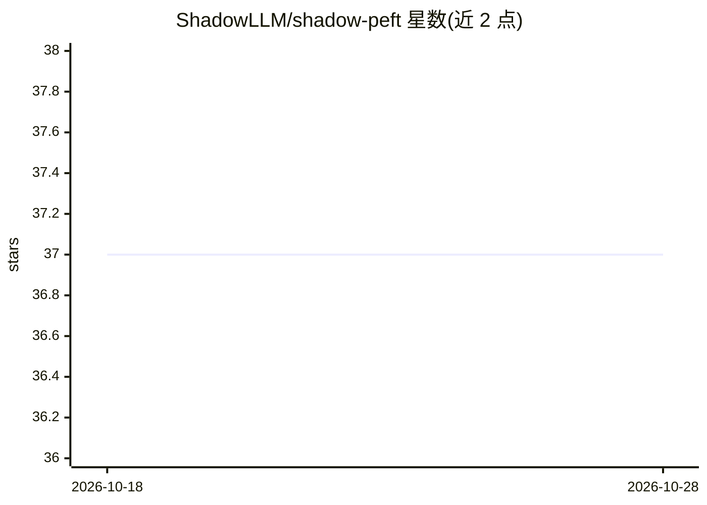

# ShadowLLM/shadow-peft

⭐ 37 · Python · MIT · 推送 2026-09-11 · [GitHub](https://github.com/ShadowLLM/shadow-peft) · [官网](https://arxiv.org/abs/2604.19254) · 组织维护

**参数高效微调框架：用可拆卸 Shadow 网络适配冻结大模型**

面向 LLM 研究与开发者的 PEFT 框架：在冻结的基座模型旁并行运行一个轻量 Shadow 网络，通过 ShadowInjectionModel 与 ShadowUpdateModel 在每个解码层注入修正。Shadow 模块与骨干架构解耦，可独立训练、存储、部署与版本管理，适配边缘计算场景；支持从小模型预训练初始化 Shadow 并复用为更大骨干的适配模块。兼容多数 Hugging Face decoder-only 模型（LLaMA、Mistral、Qwen、GPT-2 等）。限制：KV cache 被禁用、基座模型始终冻结、基座需至少 2 个解码层。

## 筛选速览

| 维度 | 判定 | 备注 |
|---|---|---|
| AI 角色 | `ai-ecosystem` | LLM/agent 周边工具 |
| 许可风险 | `permissive` | MIT |
| 部署形态 | `library` | 以包/库形式分发 |
| 模型依赖 | — | README 未给出锁定关系 |
| 硬件要求 | — | 无带数字的原话,不猜 |
| 安装摩擦 | `low` | 无编译、无系统依赖或容器化 |
| 成熟度 | — | 结构信号不足 |

## 能力要点

- Shadow 网络与冻结骨干并行运行，按层注入修正
- Shadow 模块可独立训练/存储/部署并独立版本管理
- 支持 ShadowForCausalLM 生成/训练与序列分类任务封装
- 仅保存适配器权重（shadow_adapter.safetensors），可推送/加载自 Hugging Face Hub

## 适用场景

- 在边缘设备上以轻量适配模块微调冻结的大模型
- 为不同大模型骨干复用同一预训练 Shadow 适配模块
- 以少量参数做 LLM 的生成或分类任务微调

## 场景标签

`微调` · 领域:训练与推理

## 证据(README 行号)

> L12: **ShadowPEFT** is a parameter-efficient fine-tuning (PEFT) framework that augments a frozen large base model with a
> L41: ShadowPEFT is **architecture-agnostic** for most Hugging Face *decoder-only* transformer models whose decoder layer

## 星数曲线

2026-10-18 37 → 2026-10-28 37（+0）

---
*卡片 v1 · prompt 1.4 · 生成 2026-10-25 · 置信度 high · 依据 README sha `346df5bfd13b` · [字段定义](../../DATASET.md)*
