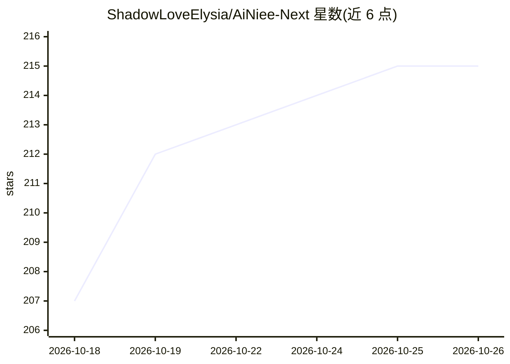

# ShadowLoveElysia/AiNiee-Next

⭐ 215 · Python · AGPL-3.0 · 推送 2026-10-20 · [GitHub](https://github.com/ShadowLoveElysia/AiNiee-Next) · 个人维护 · 中文 README

**AiNiee 优化分支：面向批量长篇内容的 LLM 翻译 CLI/TUI 工具**

基于 AiNiee 核心翻译逻辑的非官方命令行版本，用 uv 管理 Python 环境，面向长时间挂机、批量任务、服务器部署与自动化场景。支持 20 多种文件格式、多 Profile 配置、批量任务队列、插件系统、RAG 译文参考、Web 监控面板与可选 MCP 服务（可被 WorkBuddy、豆包等 Agent 客户端调用）。兼容主流在线 API、第三方中转与本地模型，支持多 API 故障转移，可在 Windows/Linux/macOS/Android(Termux) 运行。声明核心翻译算法与原版 AiNiee 保持一致。

## 筛选速览

| 维度 | 判定 | 备注 |
|---|---|---|
| AI 角色 | `ai-native` | 本体是模型或模型工具 |
| 许可风险 | `viral` | AGPL-3.0 |
| 部署形态 | `library` | 以包/库形式分发 |
| 模型依赖 | — | README 未给出锁定关系 |
| 硬件要求 | — | 无带数字的原话,不猜 |
| 安装摩擦 | `low` | 无编译、无系统依赖或容器化 |
| 成熟度 | — | 结构信号不足 |

## 能力要点

- 支持 Epub/Docx/Txt/Srt 等 20 多种格式，aiohttp 异步并发 100+
- 批量任务队列、多 Profile、断点续传与自动重试
- 可选 MCP 服务，外部 Agent 客户端可直接调用翻译能力
- Web 控制面板实时展示 RPM/TPM 与任务进度，含费用预估

## 适用场景

- 长时间挂机批量翻译长篇小说/电子书
- 通过外部 Agent 客户端以对话方式提交翻译任务
- 在无图形界面的服务器上运行并远程监控翻译队列

## 场景标签

 · 领域:LLM 应用/翻译工具

## 证据(README 行号)

> L9: **AiNiee-Next** 是基于 AiNiee 核心翻译逻辑开发的命令行版本。项目使用 **uv** 管理 Python 环境，并针对长时间运行、批量任务、服务器部署和自动化使用做了大量改进。
> L11: 项目以 CLI/TUI 为主要操作界面，同时提供 Web 控制面板、任务队列、插件系统和 MCP 服务，适合个人翻译、长篇内容处理和需要长期挂机的批量任务。
> L62: - **模型与 API 支持**：兼容主流在线 API、第三方中转服务和本地模型，会根据接口类型给出对应的参数提示，支持 DeepSeek R1、Claude 3.5 等推理模型，并提供多 API 故障转移、自动切换和可配置的触发

## 星数曲线

2026-10-18 207 → 2026-10-26 215（+8）

---
*卡片 v1 · prompt 1.4 · 生成 2026-10-22 · 置信度 mid · 依据 README sha `703645a8a7b9` · [字段定义](../../DATASET.md)*
