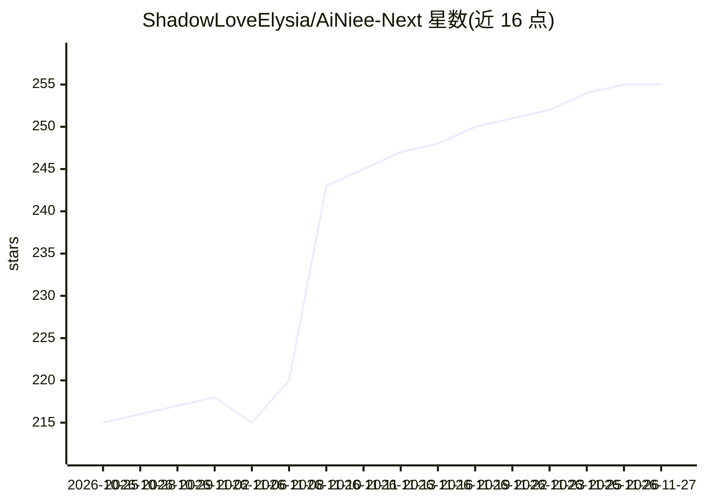

# ShadowLoveElysia/AiNiee-Next

⭐ 255 · Python · AGPL-3.0 · 推送 2026-11-26 · [GitHub](https://github.com/ShadowLoveElysia/AiNiee-Next) · 个人维护 · 中文 README

**基于大语言模型的批量翻译工具，处理小说/字幕/漫画/视频**

面向长篇文件与批量任务的本地翻译工具：支持小说、电子书、文档、字幕、游戏文本、漫画及实时音视频字幕，核心运行于 CLI/TUI 并提供网页控制台。通过 API 模式（OpenAI 兼容、Anthropic、Google、DeepSeek、本地接口）或外部 Agent/MCP 接入模型输出；提供术语表注入、角色召回、翻译记忆、断点续传、补译校验与队列定时等批处理机制。依赖 Python 3.12 与 uv；漫画、实时同传与视频模块需另行安装扩展环境。基于 AiNiee 核心翻译逻辑开发，遵循 AGPL-3.0。

## 筛选速览

| 维度 | 判定 | 备注 |
|---|---|---|
| AI 角色 | `ai-native` | 本体是模型或模型工具 |
| 许可风险 | `viral` | AGPL-3.0 |
| 部署形态 | `self-host` | docker 或自建部署 |
| 模型依赖 | — | README 未给出锁定关系 |
| 硬件要求 | — | 无带数字的原话,不猜 |
| 安装摩擦 | `low` | 无编译、无系统依赖或容器化 |
| 成熟度 | — | 结构信号不足 |

## 能力要点

- 支持小说、EPUB、字幕、游戏文本、漫画、PDF 等多格式的提取与回写
- 按需注入术语表、角色召回与分卷时间线，减少跨卷译名错乱
- 断点续传与行级补译，中断后不重复请求已翻内容
- 提供 MCP Server 与 Skills HTTP/CLI 接口，可交给外部 AI 客户端推理

## 适用场景

- 批量翻译长篇小说或系列电子书并保持译名一致
- 本地化游戏文本与字幕文件（Ren'Py、SRT、ASS 等）
- 漫画汉化：OCR、翻译、修补与图层编辑导出
- 实时同传系统音频或离线视频生成软/硬字幕

## 场景标签

`OCR` · 领域:感知与多模态

## 证据(README 行号)

> L5: AiNiee-Next 是一个基于大语言模型的批量翻译工具，支持小说、电子书、文档、字幕、游戏文本、漫画以及实时音视频字幕的处理。
> L7: 程序核心运行在命令行与终端交互菜单（CLI/TUI）中，同时提供网页控制台，以及供外部 AI 客户端调用的 MCP 和 Skills 接口，既可以拿来快速翻单本文件，也适合长篇系列和批量任务的长期处理。

## 星数曲线

2026-10-25 215 → 2026-11-27 255（+40）

---
*卡片 v1 · prompt 1.4 · 生成 2026-11-27 · 置信度 high · 依据 README sha `95d862741075` · [字段定义](../../DATASET.md)*
