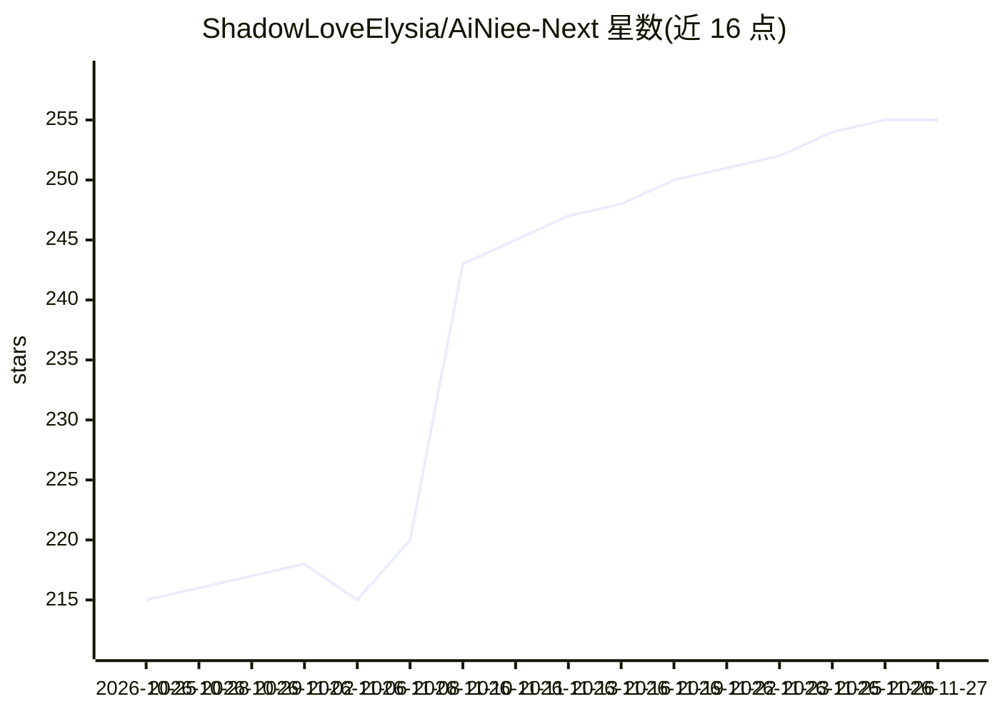

# ShadowLoveElysia/AiNiee-Next

⭐ 255 · Python · AGPL-3.0 · 推送 2026-11-26 · [GitHub](https://github.com/ShadowLoveElysia/AiNiee-Next) · 个人维护 · 中文 README

**基于大语言模型的批量翻译工具，处理小说/字幕/漫画等**

以 CLI/TUI 为主界面的大语言模型批量翻译工具，覆盖小说、电子书、文档、字幕、游戏文本、漫画与实时音视频字幕。核心机制包括术语表与角色设定的按需注入、翻译记忆与剧情记忆保持一致性、行级校验与漏译补译、断点续传缓存；另提供 Web 控制台、Tauri 桌面端，以及供外部 AI 客户端调用的 MCP/Skills 接口。文本任务安装后即可用，漫画、同传、视频需另行运行扩展脚本安装推理环境。基于 AiNiee 核心翻译逻辑开发，AGPL-3.0 协议。

## 筛选速览

| 维度 | 判定 | 备注 |
|---|---|---|
| AI 角色 | `ai-native` | 本体是模型或模型工具 |
| 许可风险 | `viral` | AGPL-3.0 |
| 部署形态 | `self-host` | docker 或自建部署 |
| 模型依赖 | local-ok | 支持本地模型 |
| 硬件要求 | — | 无带数字的原话,不猜 |
| 安装摩擦 | `low` | 无编译、无系统依赖或容器化 |
| 成熟度 | — | 结构信号不足 |

## 能力要点

- 支持小说、EPUB、字幕、游戏工程（Ren'Py/Translator++）、漫画、实时同传等多类内容翻译
- 断点续传缓存、批量补译与占位符/代码块保护等容错机制
- MCP Server 与 Skills HTTP/CLI 服务，可将翻译推理交给外部 AI 客户端
- 队列、Cron 定时与文件夹监听自动化处理

## 适用场景

- 批量翻译长篇小说、系列电子书并保持译名一致
- 本地化游戏文本和字幕文件
- 漫画汉化并用网页图层编辑器精修导出
- 直播实时字幕同传

## 场景标签

 · 领域:翻译/本地化工具

## 证据(README 行号)

> L5: AiNiee-Next 是一个基于大语言模型的批量翻译工具，支持小说、电子书、文档、字幕、游戏文本、漫画以及实时音视频字幕的处理。
> L38:  - **API 模式（最常用）**：在接口管理里选择平台（支持 OpenAI 兼容接口、Anthropic、Google、DeepSeek 以及 Sakura / LocalLLM 等本地模型接口），填写接口地址、API Key

## 星数曲线

2026-10-25 215 → 2026-11-27 255（+40）

---
*卡片 v1 · prompt 1.4 · 生成 2026-11-25 · 置信度 high · 依据 README sha `7fd03883aa62` · [字段定义](../../DATASET.md)*
