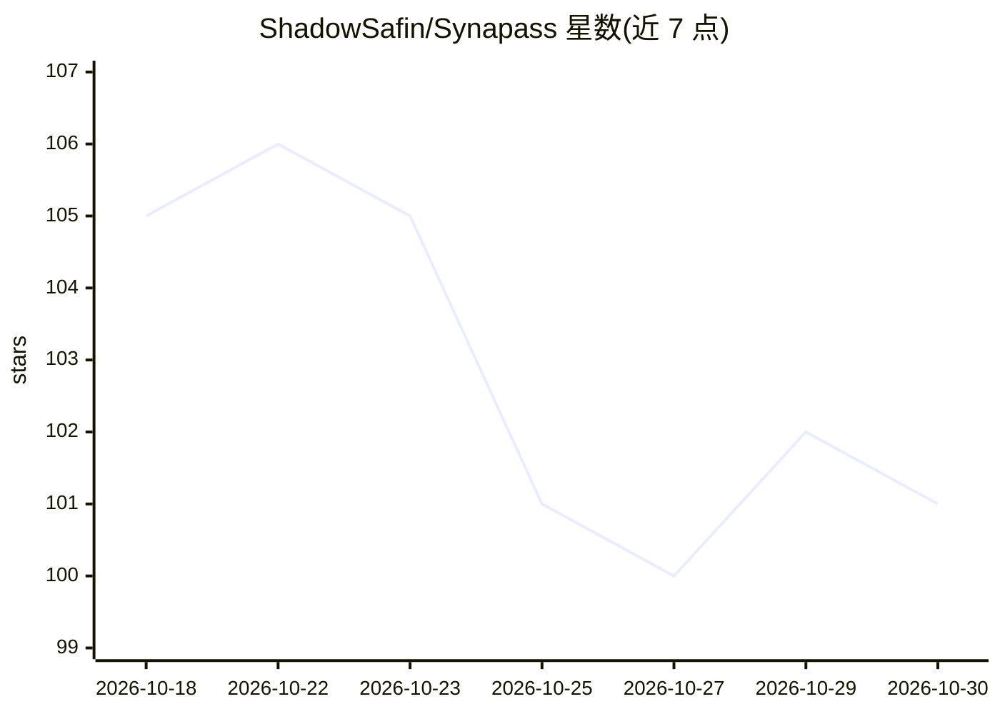

# ShadowSafin/Synapass

⭐ 101 · Go · Apache-2.0 · 推送 2026-10-18 · [GitHub](https://github.com/ShadowSafin/Synapass) · [官网](synapass.com) · 个人维护

**OpenAI 兼容的多供应商 AI 推理网关与控制平面**

位于应用与模型供应商之间的推理网关：对外暴露单一 OpenAI 兼容端点，按请求在多供应商间路由（priority/weighted/lowest_cost/lowest_latency/highest_quality 五种策略），提供有序故障转移、按模型/租户/密钥等维度匹配的策略引擎、请求前成本上限与日/月预算、精确/前缀/语义三级缓存（默认关闭）及带 explain 视图的可观测性。配套 Next.js 仪表盘管理供应商、模型、租户、密钥、工具与缓存。部署支持 Docker Compose 一键脚本、原生 systemd 与 Windows 桌面应用。

## 筛选速览

| 维度 | 判定 | 备注 |
|---|---|---|
| AI 角色 | `ai-ecosystem` | LLM/agent 周边工具 |
| 许可风险 | `permissive` | Apache-2.0 |
| 部署形态 | `desktop` | 安装包/桌面程序 |
| 模型依赖 | — | README 未给出锁定关系 |
| 硬件要求 | — | 无带数字的原话,不猜 |
| 安装摩擦 | `low` | 无编译、无系统依赖或容器化 |
| 成熟度 | — | 结构信号不足 |

## 能力要点

- 五种路由策略与有序故障转移链
- 策略引擎 + 请求前成本上限 + 日/月预算
- 精确/前缀/语义三级租户隔离缓存（默认关闭）
- 每请求可解释路由（explain 端点）与 Grafana/Prometheus/Loki 可观测性

## 适用场景

- 多 AI 供应商接入统一为一个 OpenAI 兼容端点
- 生产流量按策略路由、故障转移与成本控制
- 运营团队通过仪表盘管理供应商、租户、密钥与预算
- 审计每条请求的路由决策与花费

## 场景标签

`模型网关` · 领域:Agent 开发

## 证据(README 行号)

> L38: Synapass is an **inference gateway** and **control plane**. It sits between your
> L39: applications and your model providers, presents a single OpenAI-compatible

## 星数曲线

2026-10-18 105 → 2026-10-30 101（-4）

---
*卡片 v1 · prompt 1.4 · 生成 2026-10-23 · 置信度 high · 依据 README sha `b61b2e3552ef` · [字段定义](../../DATASET.md)*
