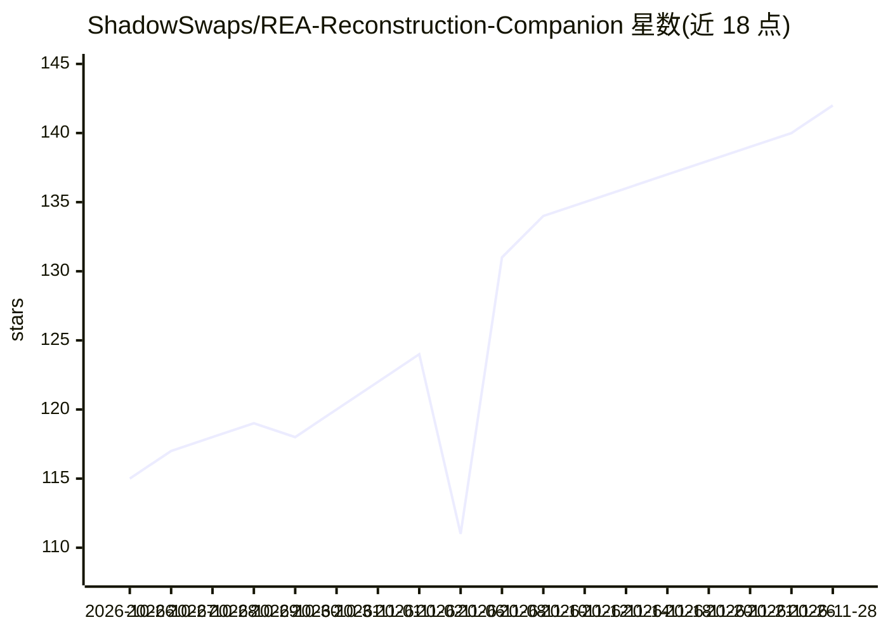

# ShadowSwaps/REA-Reconstruction-Companion

⭐ 142 · JavaScript · MIT · 推送 2026-10-30 · [GitHub](https://github.com/ShadowSwaps/REA-Reconstruction-Companion) · 个人维护

**给 AI agent 用的 REA 软件重建技能：理解、规划、重建并验证软件**

以 Agent Skills 格式（纯 Markdown 指令与参考文档）分发的开源技能，供能读取本地技能文件的 agent 使用，配合 REA 工具或其提供的证据完成四类工作：从观察/文件/录像提取行为与需求、制定重建计划与验收标准、按请求增量实现、对照证据做差分模糊测试与变异测试等验证。不绑定特定模型或 AI 提供商，无 SDK、Python 依赖与遥测；安装器需 Node.js 20+，仅用标准库、无需 npm install。安装器默认禁止触发可能产生费用的操作。

## 筛选速览

| 维度 | 判定 | 备注 |
|---|---|---|
| AI 角色 | `ai-ecosystem` | LLM/agent 周边工具 |
| 许可风险 | `permissive` | MIT |
| 部署形态 | `library` | 以包/库形式分发 |
| 模型依赖 | — | README 未给出锁定关系 |
| 硬件要求 | — | 无带数字的原话,不猜 |
| 安装摩擦 | `low` | 无编译、无系统依赖或容器化 |
| 成熟度 | — | 结构信号不足 |

## 能力要点

- 纯 Markdown Agent Skills 格式，无模型 SDK、付费 API、Python 依赖与遥测
- 支持 Claude Code、Codex 及通过 --skills-dir 的通用客户端安装
- 可选 REA 集成规则与默认关闭的每周更新检查，均需用户批准
- 安装命令提供 --dry-run 预览与 --check 校验，含备份与路径冲突检查

## 适用场景

- 分析一个既有软件的行为、需求与未解问题并形成文档
- 规划并按请求增量重建某个工作流、文件格式或函数
- 对重建结果做证据对照、失败测试与性能测量验证

## 场景标签

`编码 Agent` · 领域:编码与开发

## 证据(README 行号)

> L7: An open-source skill for AI agents, designed to work with REA. A skill is a set of instructions and reference guides
> L48: Use an agent that can read local skill files and, for installation or live investigation, run local commands. The c
> L64: Codex and Claude Code both support filesystem skills. Their discovery locations and invocation syntax differ; the i

## 星数曲线

2026-10-26 115 → 2026-11-28 142（+27）

---
*卡片 v1 · prompt 1.4 · 生成 2026-11-28 · 置信度 mid · 依据 README sha `d00684b7c917` · [字段定义](../../DATASET.md)*
