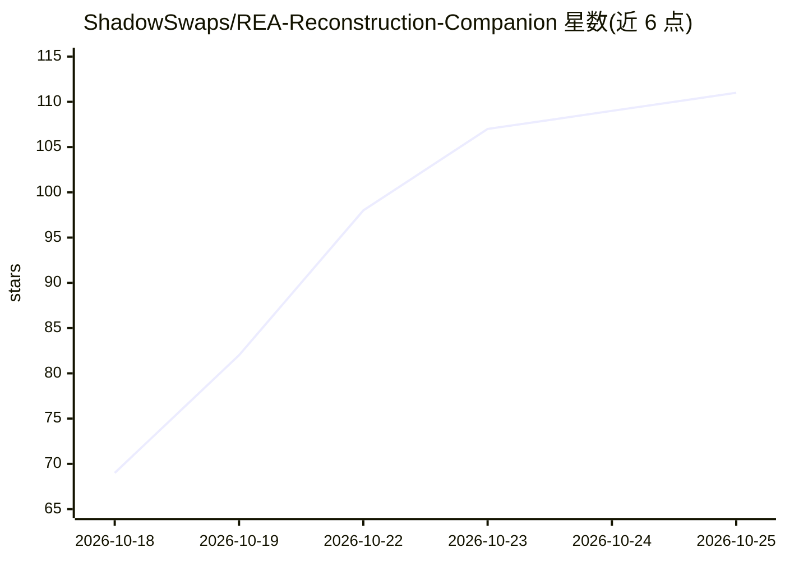

# ShadowSwaps/REA-Reconstruction-Companion

⭐ 115 · JavaScript · MIT · 推送 2026-10-23 · [GitHub](https://github.com/ShadowSwaps/REA-Reconstruction-Companion) · 个人维护

**面向 Claude Code/Codex 的软件逆向重建 Agent 技能插件**

开源、模型无关的 Agent Skill，与逆向工程技能 REA 配合使用：把逆向证据转化为需求、架构、实施路线图与可测试代码。支持理解规划、限域重建、单一功能调查、既有重建改进与断点续作等模式，强调证据链接、区分观察与推断、报告差异。通过 node install.mjs 安装到 Claude Code、Codex 或通用客户端的 skills 目录；便携核心不依赖任何模型 SDK 或付费 API，与 REA 的集成为可选项。

## 筛选速览

| 维度 | 判定 | 备注 |
|---|---|---|
| AI 角色 | `ai-ecosystem` | LLM/agent 周边工具 |
| 许可风险 | `permissive` | MIT |
| 部署形态 | `library` | 以包/库形式分发 |
| 模型依赖 | — | README 未给出锁定关系 |
| 硬件要求 | — | 无带数字的原话,不猜 |
| 安装摩擦 | `low` | 无编译、无系统依赖或容器化 |
| 成熟度 | — | 结构信号不足 |

## 能力要点

- 把逆向证据转化为需求、架构、路线图与可测试实现
- 便携核心无模型 SDK/付费 API 依赖，集成为可选
- 支持 Claude Code、Codex 与通用客户端（--skills-dir）安装
- 提供 --dry-run/--check 安装检查与断点续作（checkpoint）机制

## 适用场景

- 在重建旧软件前先获得有证据支撑的行为与需求文档
- 让 agent 按限定范围重建类似工具并验证行为
- 调查单一功能或格式，产出输入/输出/错误的契约与验收用例
- 改动既有重建时选择受影响的回归检查并保留历史结果

## 场景标签

`编码 Agent` · 领域:编码与开发

## 证据(README 行号)

> L7: An open-source, model-independent Agent Skill that works with REA. Turn reverse-engineering evidence into requiremen
> L18: **Start with the installation prompt below**, or use the manual commands. The portable core has no model SDK or pai

## 星数曲线

2026-10-18 69 → 2026-10-25 111（+42）

---
*卡片 v1 · prompt 1.4 · 生成 2026-10-23 · 置信度 mid · 依据 README sha `0d206a6f1a68` · [字段定义](../../DATASET.md)*
