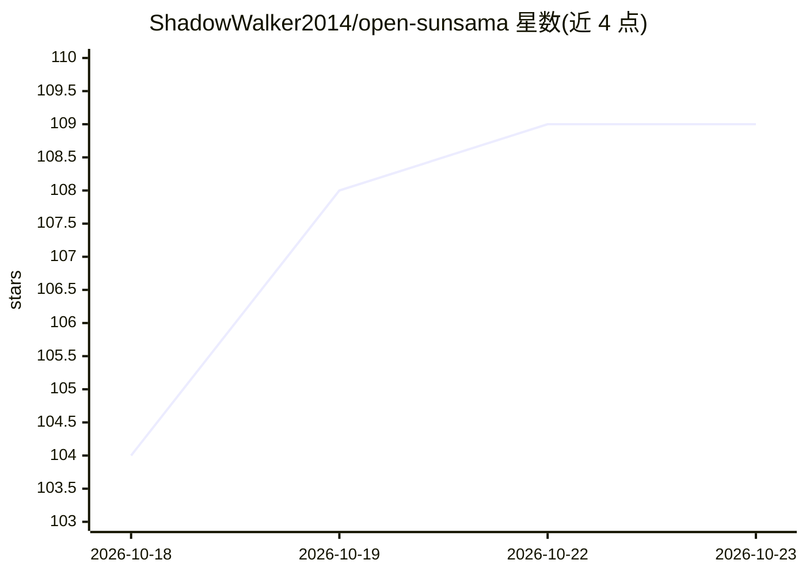

# ShadowWalker2014/open-sunsama

⭐ 109 · TypeScript · NOASSERTION · 推送 2026-10-20 · [GitHub](https://github.com/ShadowWalker2014/open-sunsama) · [官网](https://opensunsama.com) · 个人维护

**开源每日计划器：看板、时间块、专注模式，可被 Claude/ChatGPT 通过 MCP 操控**

受 Sunsama 启发的开源日程与任务管理工具：按日组织的看板、拖拽时间块日历、专注计时器、例行任务与未完成事项顺延，支持 Google/Outlook/iCloud 日历同步，提供 Web、桌面（macOS/Windows/Linux）与移动端应用。AI 集成方式是内置 MCP 服务器：粘贴一个 URL 即可让 Claude、ChatGPT、Claude Code、Cursor 等 agent 通过 OAuth 连接，调用 24 个工具读写任务、子任务与时间块；另提供带作用域 API key 的 REST API。可云端使用或用 Docker 自托管，自托管时桌面/移动端应用仅连接官方站点，需使用 Web 版。

## 筛选速览

| 维度 | 判定 | 备注 |
|---|---|---|
| AI 角色 | `ai-enhanced` | 去掉 AI 部分产品仍成立 |
| 许可风险 | `none` | NOASSERTION |
| 部署形态 | `self-host` | docker 或自建部署 |
| 模型依赖 | — | README 未给出锁定关系 |
| 硬件要求 | — | 无带数字的原话,不猜 |
| 安装摩擦 | `low` | 无编译、无系统依赖或容器化 |
| 成熟度 | — | 结构信号不足 |

## 能力要点

- 一键 OAuth 连接器，Claude/ChatGPT 等 MCP 客户端可读写任务与日程（24 个 MCP 工具）
- 看板式每日规划、拖拽时间块日历、专注模式与任务顺延
- Web/桌面/移动三端应用，支持 Google/Outlook/iCloud 日历同步
- 可 Docker 自托管（PostgreSQL、Redis、API），并提供带作用域 key 的 REST API

## 适用场景

- 用看板和时间块规划每天的工作并保持专注
- 让 Claude 或 ChatGPT 代为整理任务、排时间块
- 团队或个人在自有服务器上自托管日程工具

## 场景标签

 · 领域:生产力/日程任务管理

## 证据(README 行号)

> L25: - **🤖 Your AI plans with you.** Claude and ChatGPT can read your schedule, create and prioritize tasks, time-block 
> L277: An open-source daily planner and task manager inspired by Sunsama. You plan each day on a kanban board, time-block

## 星数曲线

2026-10-18 104 → 2026-10-23 109（+5）

---
*卡片 v1 · prompt 1.4 · 生成 2026-10-23 · 置信度 high · 依据 README sha `10dc417d5650` · [字段定义](../../DATASET.md)*
