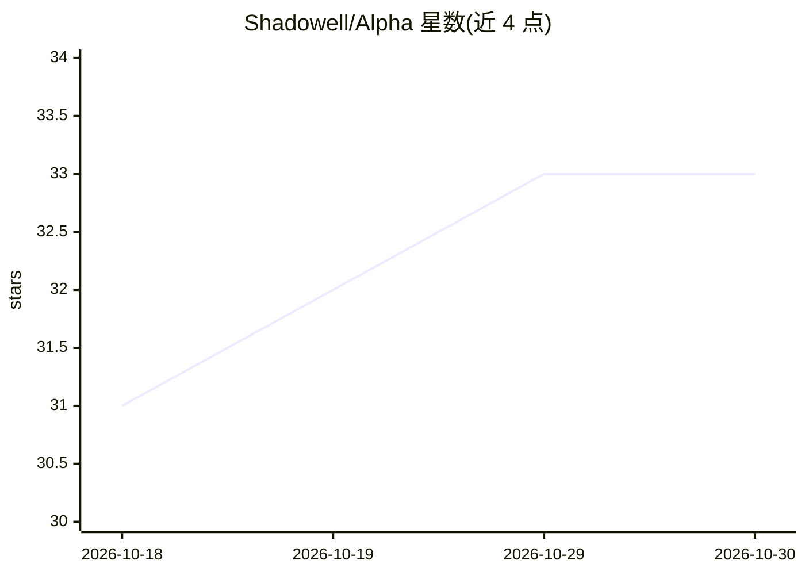

# Shadowell/Alpha

⭐ 33 · Python · MIT · 推送 2026-10-26 · [GitHub](https://github.com/Shadowell/Alpha) · 个人维护 · 中文 README

**A股自进化量化选股系统：Kronos K线预测 + Hermes Agent 闭环**

面向中国 A 股市场的开源量化选股系统，结合 Kronos 金融 K 线基础模型（默认 Kronos-base，102.3M 参数，输出未来 3 日 OHLC 预测）与 Hermes Agent 自进化智能体，形成观察→思考→校验→进化的闭环。功能覆盖三池漏斗选股（复合候选→重点关注→买入池）、公告事件选股（规则+LLM 双引擎打分）、热门股多代理讨论（TradingAgents + DeepSeek API）、智能监控与模拟盘。以 FastAPI 提供 50+ REST 端点与 8 页签 Web UI，数据源以 Tushare 为主、东财/新浪降级，支持 Docker 一键部署。Hermes Agent 通过 MCP Server 暴露 16 个工具，Agent 不可用时降级为单次 LLM 调用。

## 筛选速览

| 维度 | 判定 | 备注 |
|---|---|---|
| AI 角色 | `ai-native` | 本体是模型或模型工具 |
| 许可风险 | `permissive` | MIT |
| 部署形态 | `self-host` | docker 或自建部署 |
| 模型依赖 | — | README 未给出锁定关系 |
| 硬件要求 | `cpu-ok` | |
| 安装摩擦 | `low` | 无编译、无系统依赖或容器化 |
| 成熟度 | — | 结构信号不足 |

## 能力要点

- 三池漏斗选股模型：12 条原子规则自由组合，约 30 秒扫描全 A 股 5000 只
- Kronos K 线预测全链路嵌入：选股/公告/监控场景均展示 30 日 K 线 + 3 日预测叠加
- Hermes Agent 自进化闭环：MCP 16 工具、定时盘后/公告复盘、并发与熔断保护
- 模拟盘含费用模型（佣金/印花税/滑点），零资金验证策略

## 适用场景

- A股研究者本地搭建可复现的选股与 K 线预测系统
- 用自然语言/Agent 方式做盘后复盘与公告事件分析
- 在不投入真实资金的情况下回测与模拟验证选股策略

## 场景标签

`金融量化` · 领域:学习与行业

## 证据(README 行号)

> L22: **Alpha** is an open-source, self-evolving quantitative stock screening system for the Chinese A-share market. It c
> L289: ### 在 Alpha 中的全链路集成

## 星数曲线

2026-10-18 31 → 2026-10-30 33（+2）

---
*卡片 v1 · prompt 1.4 · 生成 2026-10-26 · 置信度 mid · 依据 README sha `f5bd59fa5fa7` · [字段定义](../../DATASET.md)*
