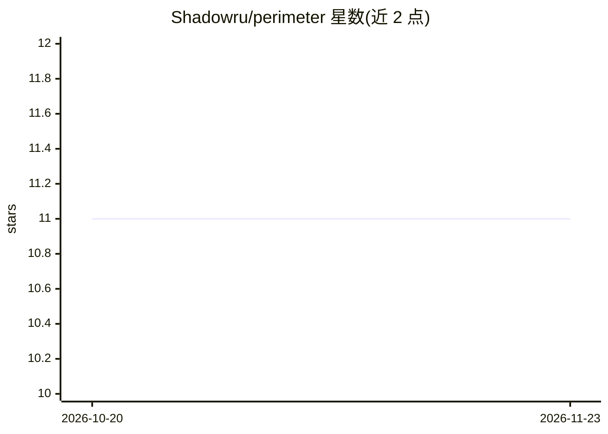

# Shadowru/perimeter

⭐ 11 · Python · NOASSERTION · 推送 2026-09-04 · [GitHub](https://github.com/Shadowru/perimeter) · [官网](https://shadowru.github.io/perimeter/) · 个人维护

**1C 企业数据的本地 AI 代理：离线问答与草稿生成**

面向 CIS 地区企业的完全本地化 1C 数据代理：通过 OData 或反向连接接入 1C:Предприятие 8.3，从磁盘运行 GLM-5.2（744B MoE）推理，全程不调用外部 API，通过配置、netguard 运行时防护与 netns CI 测试强制执行气隙隔离。回答附带文档引用，仅生成草稿，写入 1C 需人工确认，所有操作记录在 append-only 审计日志。安装需 Python 3.12+ 与 gcc/make，GLM-5.2 需 500GB NVMe 与 128GB 内存。

## 筛选速览

| 维度 | 判定 | 备注 |
|---|---|---|
| AI 角色 | `ai-native` | 本体是模型或模型工具 |
| 许可风险 | `none` | NOASSERTION |
| 部署形态 | `None` |  |
| 模型依赖 | — | README 未给出锁定关系 |
| 硬件要求 | — | 无带数字的原话,不猜 |
| 安装摩擦 | `low` | 无编译、无系统依赖或容器化 |
| 成熟度 | — | 结构信号不足 |

## 能力要点

- GLM-5.2 权重从磁盘本地推理，无外部 API 调用（气隙规则由配置/netguard/CI 三层强制）
- OData 与反向连接两种 1C 接入通道，均无需修改配置
- 仅生成草稿，数据变更需人工确认，附带 append-only 审计日志
- 推理后端为本地 OpenAI 兼容服务器（colibri / llama.cpp）

## 适用场景

- 用自然语言查询 1C 中的未过账单据与对账信息
- 基于历史订单生成发票草稿后人工确认过账
- 在禁止外网的封闭环境中部署 AI 助手

## 场景标签

`AI 助手` · 领域:对话与助手

## 证据(README 行号)

> L3: Агент по данным 1С, работающий **полностью локально**: инференс GLM-5.2 (744B MoE) с диска через [colibri], интеграц
> L11: Ответы всегда со ссылками на документы («№РТ-0002 от 10.07.2026»). Агент **никогда не изменяет данные в 1С без подт

## 星数曲线

2026-10-20 11 → 2026-11-23 11（+0）

---
*卡片 v1 · prompt 1.4 · 生成 2026-11-18 · 置信度 high · 依据 README sha `b993b135b69c` · [字段定义](../../DATASET.md)*
