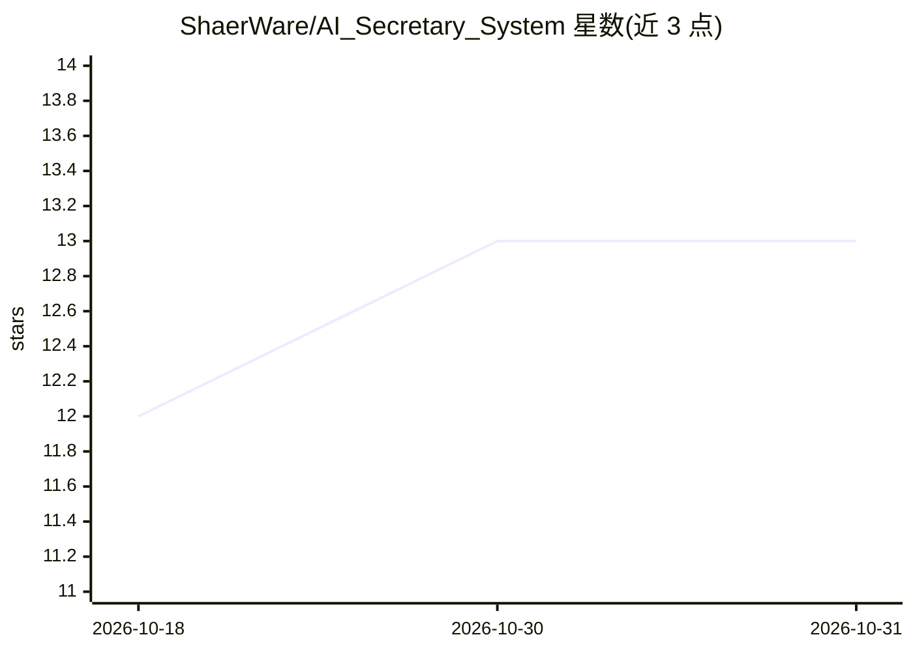

# ShaerWare/AI_Secretary_System

⭐ 13 · Python · MIT · 推送 2026-10-29 · [GitHub](https://github.com/ShaerWare/AI_Secretary_System) · [官网](https://shaerware.github.io/) · 组织维护

**自托管 AI 电话秘书/客服/销售系统，带语音克隆与本地 LLM**

面向需要私密自部署的中小企业与个人：以 FastAPI 编排器 + Vue 3 管理面板构成虚拟秘书系统，通过 Telegram/WhatsApp 机器人、网站聊天部件、GSM 电话模块与用户对话。语音侧支持 XTTS v2/OpenVoice 声音克隆与 Piper 预训练语音（共 5 音色），STT 支持 Vosk 实时流式与 Whisper 批处理。LLM 侧可用本地 vLLM 运行 Qwen2.5-7B/Llama-3.1-8B/DeepSeek-7B 并支持 LoRA 微调热切换，也可接 Gemini/OpenAI/Claude/DeepSeek/Kimi/OpenRouter 云端。SQLite（35 表）+ 可选 Redis 存储，含 amoCRM 集成与销售漏斗。GPU 模式需 12GB+ VRAM，CPU 模式需 Gemini API key。

## 筛选速览

| 维度 | 判定 | 备注 |
|---|---|---|
| AI 角色 | `ai-native` | 本体是模型或模型工具 |
| 许可风险 | `permissive` | MIT |
| 部署形态 | `self-host` | docker 或自建部署 |
| 模型依赖 | local-ok | 支持本地模型 |
| 硬件要求 | `gpu-8g` | |
| 安装摩擦 | `low` | 无编译、无系统依赖或容器化 |
| 成熟度 | — | 结构信号不足 |

## 能力要点

- 多引擎语音：XTTS v2/OpenVoice 克隆 + Piper 预训练，Vosk 实时 STT + Whisper 批处理
- 本地 vLLM 运行 Qwen/Llama/DeepSeek + LoRA 微调管道与适配器热切换，支持 offline-first
- 20 标签页 Vue 3 PWA 管理面板：多用户 RBAC、i18n、GPU 监控、审计日志
- 多实例 Telegram/WhatsApp 机器人与网站部件，GSM 电话（SIM7600E-H）、amoCRM 与支付集成

## 适用场景

- 搭建不打扰隐私的全本地客服/销售 AI 秘书
- 通过 Telegram/WhatsApp 或网站部件自动应答客户并做 FAQ 和销售漏斗
- 用自有语音样本克隆品牌声音做语音应答
- 在单卡 RTX 3060 12GB 上同时跑 LLM 与 TTS

## 场景标签

`语音 Agent` `聊天机器人` `语音合成` · 领域:对话与助手

## 证据(README 行号)

> L16: Интеллектуальная система виртуального секретаря с клонированием голоса (XTTS v2, OpenVoice), предобученными голосам
> L21: - **Speech-to-Text**: Vosk (realtime streaming) + Whisper (batch)
> L23: - **Local LLM**: vLLM с Qwen2.5-7B/Llama-3.1-8B/DeepSeek-7B + LoRA fine-tuning

## 星数曲线

2026-10-18 12 → 2026-10-31 13（+1）

---
*卡片 v1 · prompt 1.4 · 生成 2026-10-31 · 置信度 mid · 依据 README sha `9632176f600a` · [字段定义](../../DATASET.md)*
