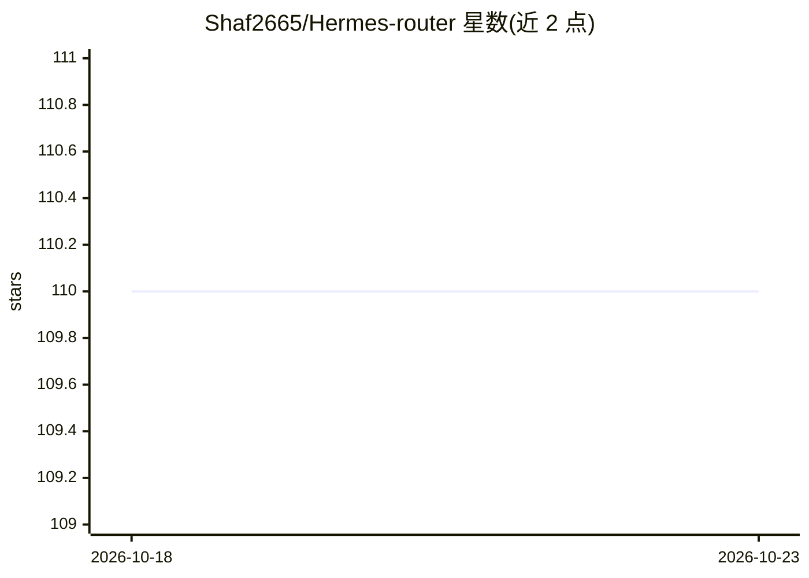

# Shaf2665/Hermes-router

⭐ 110 · Python · MIT · 推送 2026-09-30 · [GitHub](https://github.com/Shaf2665/Hermes-router) · [官网](https://hermes-router.vercel.app) · 个人维护

**给开发者的 AI 提供商路由网关：多 Key 轮换与故障转移**

部署在应用与多个 AI 提供商（Gemini、OpenRouter、Groq 等）之间的本地代理：实现 OpenAI 兼容的 chat/embeddings/models 端点与 Anthropic Messages 端点，客户端改 base URL 即可接入。核心机制包括多 Key 轮换与冷却、按难度/能力评分选择最便宜可用模型的智能路由、跨提供商故障转移与熔断、响应缓存（含可选语义缓存）、每 Key 预算限流、Web 仪表盘与 Prometheus 指标；支持 Ollama/LM Studio 本地模型兜底。单文件 Python 实现，提供一键安装脚本、hr CLI 与 Docker 部署；限制是所有配置的提供商耗尽时请求仍会失败。

## 筛选速览

| 维度 | 判定 | 备注 |
|---|---|---|
| AI 角色 | `ai-ecosystem` | LLM/agent 周边工具 |
| 许可风险 | `permissive` | MIT |
| 部署形态 | `None` |  |
| 模型依赖 | local-ok | 支持本地模型 |
| 硬件要求 | — | 无带数字的原话,不猜 |
| 安装摩擦 | `low` | 无编译、无系统依赖或容器化 |
| 成熟度 | — | 结构信号不足 |

## 能力要点

- OpenAI/Anthropic 兼容端点，改 base URL 即可接入
- 多 Key 轮换、跨提供商故障转移与熔断
- 按请求难度与模型能力评分的智能路由（选最便宜可用模型）
- Ollama/LM Studio 本地模型作为云提供商兜底

## 适用场景

- 把多个免费 AI 配额拼成一个池子，避免单提供商限流中断
- 在应用侧统一 OpenAI/Anthropic 客户端并做成本跟踪
- 用本地模型兜底降低对云端配额的依赖

## 场景标签

`模型网关` · 领域:Agent 开发

## 证据(README 行号)

> L8: **Stretch free AI quotas across providers.** hermes-router sits between your app and a pool
> L13: It implements the commonly used OpenAI-compatible chat, embeddings, and models endpoints,

## 星数曲线

2026-10-18 110 → 2026-10-23 110（+0）

---
*卡片 v1 · prompt 1.4 · 生成 2026-10-23 · 置信度 high · 依据 README sha `7011cffb9ebc` · [字段定义](../../DATASET.md)*
