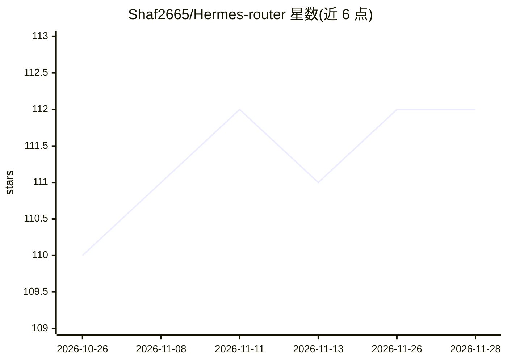

# Shaf2665/Hermes-router

⭐ 112 · Python · MIT · 推送 2026-11-27 · [GitHub](https://github.com/Shaf2665/Hermes-router) · [官网](https://hermes-router.vercel.app) · 个人维护

**面向应用开发者的多提供商 LLM 路由与故障转移代理**

位于应用与 AI 提供商池之间的路由代理，实现 OpenAI 兼容的 chat/embeddings/models 端点与 Anthropic Messages 端点，客户端改 base URL 即可接入。核心机制：跨提供商故障转移、密钥轮换与冷却、按难度评分选最便宜可用模型的智能路由、响应缓存（含可选语义缓存）、熔断器、用量分析与成本跟踪、Web 仪表盘及 Docker 多实例管理。单 Python 文件实现，Python 3.10+，需至少一个云提供商密钥或本地模型。

## 筛选速览

| 维度 | 判定 | 备注 |
|---|---|---|
| AI 角色 | `ai-ecosystem` | LLM/agent 周边工具 |
| 许可风险 | `permissive` | MIT |
| 部署形态 | `self-host` | docker 或自建部署 |
| 模型依赖 | local-ok | 支持本地模型 |
| 硬件要求 | — | 无带数字的原话,不猜 |
| 安装摩擦 | `low` | 无编译、无系统依赖或容器化 |
| 成熟度 | — | 结构信号不足 |

## 能力要点

- OpenAI 兼容 chat/embeddings/models + Anthropic Messages 端点
- 自动密钥轮换、提供商故障转移与熔断器
- 本地模型（Ollama / LM Studio）配合云端回退
- Web 仪表盘、Prometheus /metrics 与成本跟踪

## 适用场景

- 把多个免费额度提供商串成池子，一个限流自动切下一个
- 应用只需改 base_url 即可接入多家模型
- 本地 Ollama 模型为主、云端兜底的混合推理
- 监控多实例路由器的用量与花费

## 场景标签

`模型网关` · 领域:Agent 开发

## 证据(README 行号)

> L8: **Stretch free AI quotas across providers.** hermes-router sits between your app and a pool
> L13: It implements the commonly used OpenAI-compatible chat, embeddings, and models endpoints,

## 星数曲线

2026-10-26 110 → 2026-11-28 112（+2）

---
*卡片 v1 · prompt 1.4 · 生成 2026-11-28 · 置信度 high · 依据 README sha `2333df4e3ecd` · [字段定义](../../DATASET.md)*
