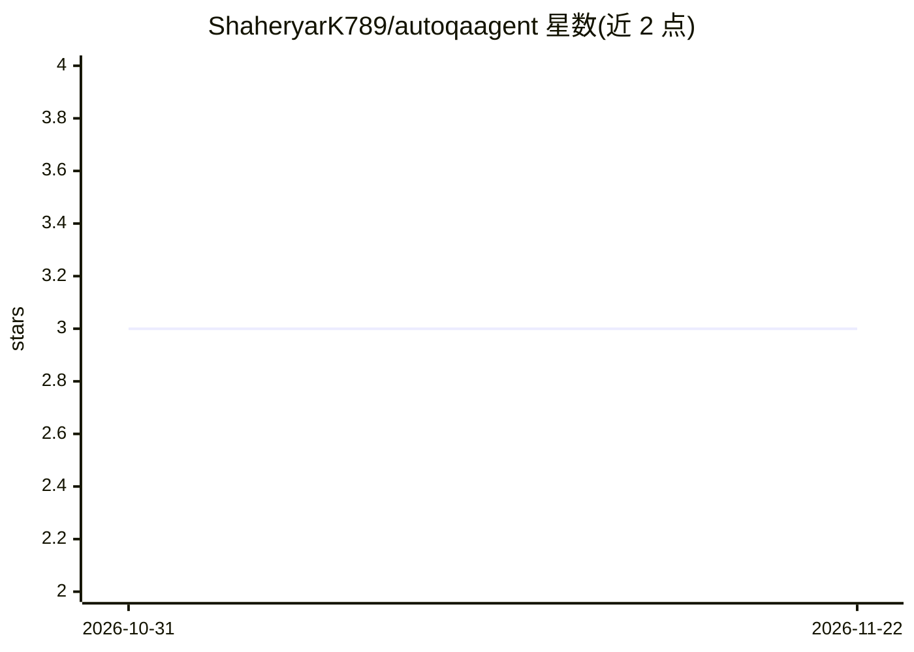

# ShaheryarK789/autoqaagent

⭐ 3 · JavaScript · MIT · 推送 2026-10-27 · [GitHub](https://github.com/ShaheryarK789/autoqaagent) · 个人维护

**给 QA/开发团队的 AI 测试 agent：探索 Web 应用并生成 Playwright 测试**

基于 Claude Code 与 Playwright 构建的自动化测试 agent：给定目标 Web 应用地址后，在真实浏览器中探索并映射用户路径，按风险规划测试项，以固定风格编写 Playwright 测试套件，执行并区分测试自身错误与真实缺陷，输出带严重级别与复现步骤的 bug 报告，并在 UI 变更后修复测试而不掩盖真实 bug。最终产物是归用户所有的普通 Playwright 套件，重跑无需 AI。要求 Node.js 22、Git 与 Claude Code 订阅，不支持原生移动/桌面应用与含 CAPTCHA/2FA 的登录。

## 筛选速览

| 维度 | 判定 | 备注 |
|---|---|---|
| AI 角色 | `ai-native` | 本体是模型或模型工具 |
| 许可风险 | `permissive` | MIT |
| 部署形态 | `library` | 以包/库形式分发 |
| 模型依赖 | locked-api |  |
| 硬件要求 | — | 无带数字的原话,不猜 |
| 安装摩擦 | `low` | 无编译、无系统依赖或容器化 |
| 成熟度 | — | 结构信号不足 |

## 能力要点

- 探索→规划→写测试→运行→修复五步流程，产出归用户所有的 Playwright 套件
- 自愈机制区分测试损坏与应用缺陷，不为掩盖 bug 而弱化测试
- 测试账号密码对 agent 不可见（浏览器替换与日志脱敏）
- 输出含旅程图、测试计划、bug 报告与可回放步骤日志

## 适用场景

- 为 Web 应用自动生成并维护回归测试套件
- 在测试环境中探索性找 bug 并生成缺陷报告
- UI 改版后自动修复失效的测试定位器

## 场景标签

`浏览器自动化` `编码 Agent` · 领域:效率与自动化

## 证据(README 行号)

> L5: An AI testing agent built on Claude Code and Playwright. Give it the address of your web app and it works like a QA 
> L9: 3. **Writes** a Playwright test suite, in a consistent house style.
> L126: The agent is Claude Code running without a chat window, driving a real browser through Playwright MCP. Its QA judg

## 星数曲线

2026-10-31 3 → 2026-11-22 3（+0）

---
*卡片 v1 · prompt 1.4 · 生成 2026-11-22 · 置信度 high · 依据 README sha `717f877822b9` · [字段定义](../../DATASET.md)*
