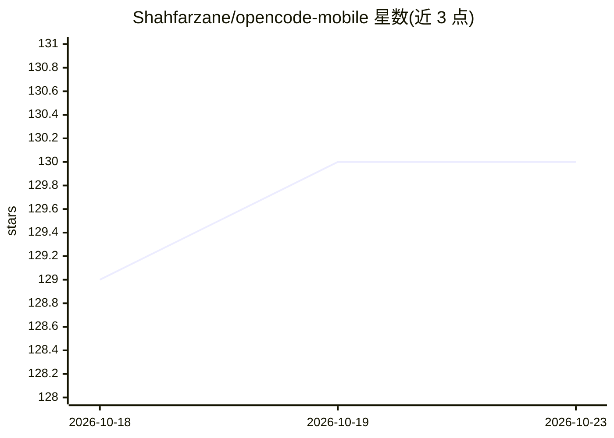

# Shahfarzane/opencode-mobile

⭐ 130 · TypeScript · MIT · 推送 2026-01-15 · [GitHub](https://github.com/Shahfarzane/opencode-mobile) · 个人维护

**OpenCode AI 编程代理的 iOS 原生移动客户端**

基于 Expo/React Native 构建的 OpenCode 移动客户端，为 OpenChamber 生态新增 iOS 应用：通过扫描二维码或手动输入 URL 连接开发机上运行的 OpenChamber Web 服务器，在手机/iPad 上实现 AI 编程代理交互。功能含实时流式响应、集成终端、Git 操作与 AI 生成提交信息、Face ID/Touch ID 令牌保护、按代理设置权限模式、会话分支等。需配合 OpenCode CLI 与 Node.js 20+ 使用；iOS 构建需 Xcode 15+ 与 EAS CLI。

## 筛选速览

| 维度 | 判定 | 备注 |
|---|---|---|
| AI 角色 | `ai-ecosystem` | LLM/agent 周边工具 |
| 许可风险 | `permissive` | MIT |
| 部署形态 | `None` |  |
| 模型依赖 | — | README 未给出锁定关系 |
| 硬件要求 | — | 无带数字的原话,不猜 |
| 安装摩擦 | `low` | 无编译、无系统依赖或容器化 |
| 成熟度 | — | 结构信号不足 |

## 能力要点

- 实时流式响应与 SSE 驱动的聊天/终端输出
- 二维码配对连接 OpenChamber 服务器，支持 Cloudflare 隧道远程访问
- Face ID/Touch ID 保护的加密令牌存储
- Git 操作与 AI 生成提交信息、集成终端、多代理并行运行

## 适用场景

- 在 iPhone/iPad 上远程查看和操控开发机上的 AI 编程代理会话
- 外出时代码审查、执行终端命令与 Git 提交
- 与 CLI/Web/桌面版共享同一会话实现跨设备接力

## 场景标签

`编码 Agent` `代码审查` · 领域:编码与开发

## 证据(README 行号)

> L3: A native iOS app for OpenCode - the AI coding agent. Built with Expo and React Native.
> L9: This is a **native mobile client** for OpenCode that lets you interact with your AI coding agent from your iPhone or

## 星数曲线

2026-10-18 129 → 2026-10-23 130（+1）

---
*卡片 v1 · prompt 1.4 · 生成 2026-10-22 · 置信度 high · 依据 README sha `cd28891c09c6` · [字段定义](../../DATASET.md)*
