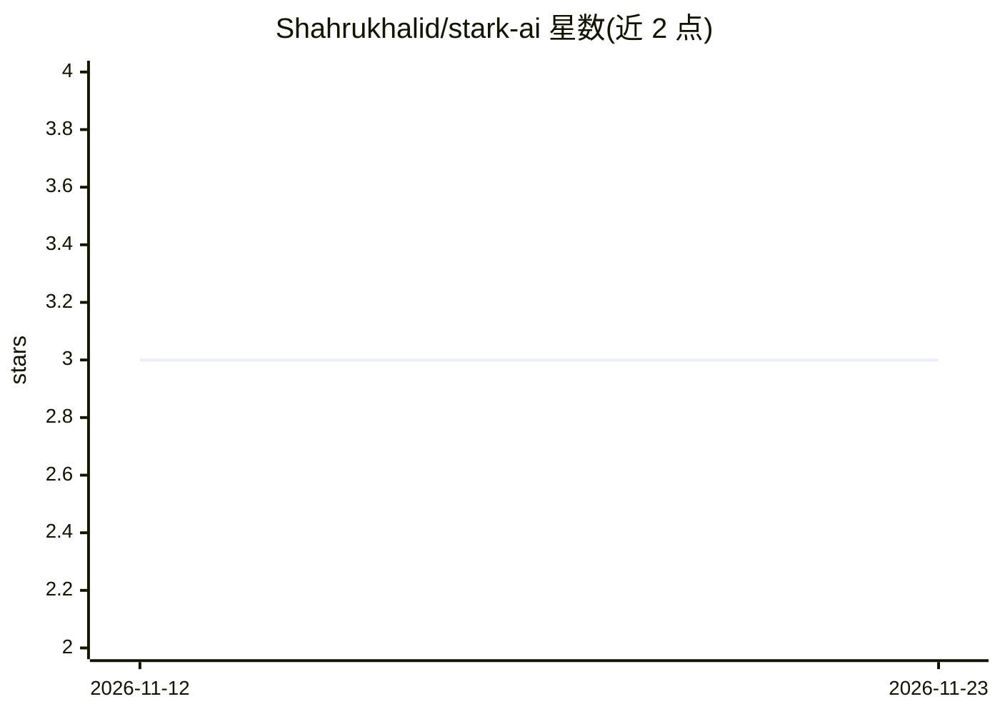

# Shahrukhalid/stark-ai

⭐ 3 · Python · MIT · 推送 2026-11-20 · [GitHub](https://github.com/Shahrukhalid/stark-ai) · [官网](https://shahrukhalid.github.io/stark-ai/) · 个人维护

**自托管的 AI 社交媒体管理器，多 agent 起草并发布帖子**

桌面应用形态的自托管社交媒体管理工具：两个主助手（Vision/Wanda）与七个专职 agent 分工完成草拟、策略检查、排期与发布，覆盖 12 个平台；每个 agent 使用各自的免费模型并带自动回退，所有发布默认需用户批准。支持语音指令（英语/乌尔都语）、政策检查、内容日历、收件箱分诊、监听与分析。提供 macOS/Windows 安装包，也可 Docker Compose 或源码运行，AI 密钥由用户自备（OpenRouter）。

## 筛选速览

| 维度 | 判定 | 备注 |
|---|---|---|
| AI 角色 | `ai-native` | 本体是模型或模型工具 |
| 许可风险 | `permissive` | MIT |
| 部署形态 | `desktop` | 安装包/桌面程序 |
| 模型依赖 | locked-api |  |
| 硬件要求 | — | 无带数字的原话,不猜 |
| 安装摩擦 | `low` | 无编译、无系统依赖或容器化 |
| 成熟度 | — | 结构信号不足 |

## 能力要点

- 七个专职 agent 分工（规划/写作/红队/发布等），各自模型与记忆
- 12 个平台真实发布，全部草稿默认需人工批准
- 视频工作室含 whisper.cpp 离线语音转文字与字幕生成
- Docker Compose 自托管，数据存本地 SQLite，密钥加密存储

## 适用场景

- 在一个应用里管理多品牌社交媒体账号的起草与发布
- 用自然语言或语音让 agent 代写帖子并排期
- 自动化内容日历、监听提及与回复草稿

## 场景标签

`多智能体` · 领域:Agent 开发

## 证据(README 行号)

> L5: Free, self-hosted AI social media manager. Talk to two assistants, Vision and Wanda, and a team of seven specialist 
> L46: Each agent has its own free model with automatic fallback, its own prompt, memory and tools.

## 星数曲线

2026-11-12 3 → 2026-11-23 3（+0）

---
*卡片 v1 · prompt 1.4 · 生成 2026-11-22 · 置信度 high · 依据 README sha `d5f5a7d2d6c6` · [字段定义](../../DATASET.md)*
