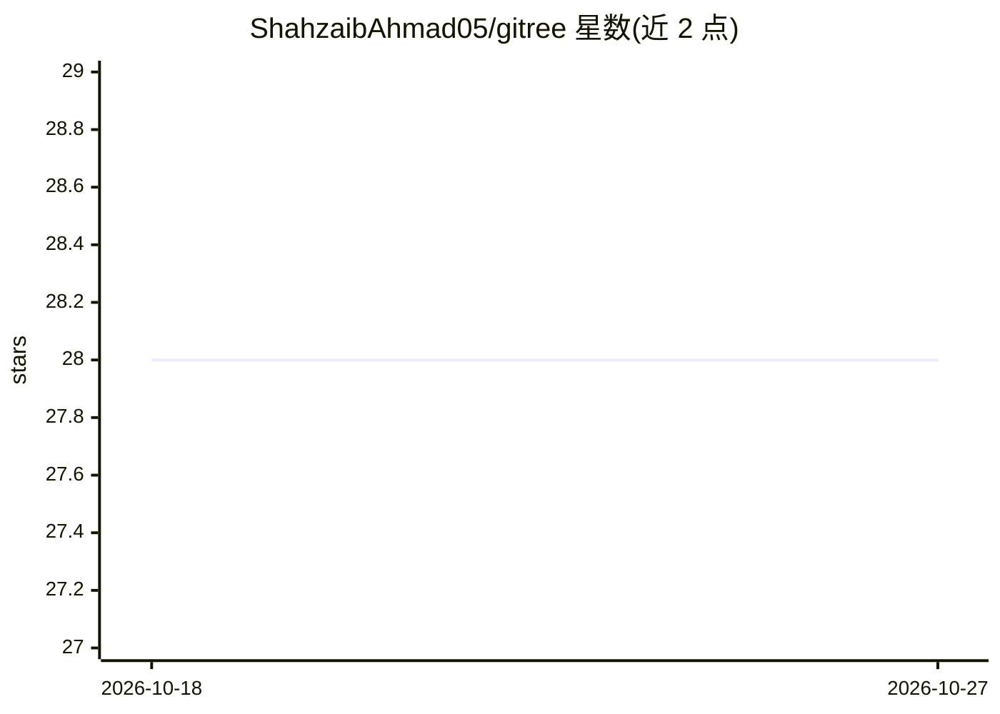

# ShahzaibAhmad05/gitree

⭐ 28 · Python · MIT · 推送 2026-02-15 · [GitHub](https://github.com/ShahzaibAhmad05/gitree) · [官网](https://pypi.org/project/gitree) · 个人维护

**开发者的 ls 升级版：查看目录结构并复制代码作为 LLM 上下文**

发布于 PyPI 的 Python CLI 工具（gitree/gt），在终端打印项目目录树，支持 emoji、隐藏文件、深度与条目限制、.gitignore 规则过滤等选项。面向需要向 LLM 提供代码上下文的开发者：可将选中代码文件与结构复制到剪贴板、导出为 tree/json/md 格式单文件、或打包 zip（可遵守 gitignore），支持交互式选择文件。提供 -m/--move 切换到根目录的终端工作流。

## 筛选速览

| 维度 | 判定 | 备注 |
|---|---|---|
| AI 角色 | `ai-ecosystem` | LLM/agent 周边工具 |
| 许可风险 | `permissive` | MIT |
| 部署形态 | `library` | 以包/库形式分发 |
| 模型依赖 | — | README 未给出锁定关系 |
| 硬件要求 | — | 无带数字的原话,不猜 |
| 安装摩擦 | `low` | 无编译、无系统依赖或容器化 |
| 成熟度 | — | 结构信号不足 |

## 能力要点

- 打印项目目录树（emoji、深度/条目限制、gitignore 过滤）
- 复制代码内容与结构到剪贴板用于 LLM 提示
- 导出为 tree/json/md 格式单文件或打包 zip
- 交互式文件选择与 --move 自动切换工作目录

## 适用场景

- 把代码库整理成文本粘贴给 LLM 做提示
- 在终端快速查看并浏览项目结构
- 按 gitignore 规则打包或导出项目内容

## 场景标签

`提示工程` · 领域:Agent 开发

## 证据(README 行号)

> L3: **An upgrade from "ls" for developers. An open-source tool to analyze folder structures and to provide code context 
> L170: |`-c`, `--copy`|**Copy** file contents and project structure to **clipboard** (great for LLM prompts).|

## 星数曲线

2026-10-18 28 → 2026-10-27 28（+0）

---
*卡片 v1 · prompt 1.4 · 生成 2026-10-26 · 置信度 high · 依据 README sha `a7b96dbb56a2` · [字段定义](../../DATASET.md)*
