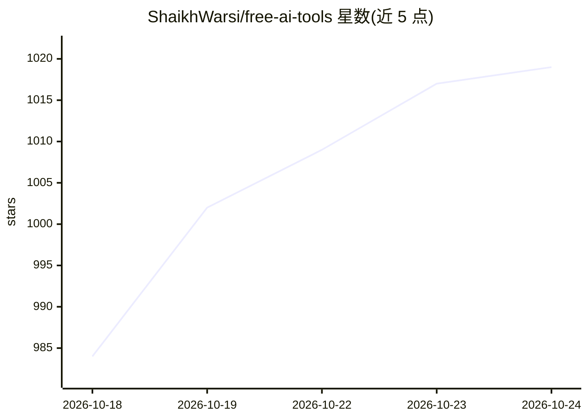

# ShaikhWarsi/free-ai-tools

⭐ 1,019 · TypeScript · MIT · 推送 2026-10-11 · [GitHub](https://github.com/ShaikhWarsi/free-ai-tools) · [官网](https://FreeAiToolsList.vercel.app) · 个人维护

**面向开发者的免费/低价 AI 工具与 LLM API 策展清单**

一个 awesome-list 形式的策展目录：汇总免费 LLM API 提供商、AI 编程 IDE、CLI 编码工具、GitHub PR 审查工具、agent 框架与 RAG 基础设施，以对比表格列出各工具的模型、免费额度、是否需要信用卡等。声明目标是帮助开发者以低成本搭建 AI 应用，并附更新日志记录价格与模型变动。清单内容为条目罗列，不提供软件本体，仅收录外部工具链接。

## 筛选速览

| 维度 | 判定 | 备注 |
|---|---|---|
| AI 角色 | `ai-knowledge` | 知识聚合/清单类 |
| 许可风险 | `permissive` | MIT |
| 部署形态 | `library` | 以包/库形式分发 |
| 模型依赖 | — | README 未给出锁定关系 |
| 硬件要求 | — | 无带数字的原话,不猜 |
| 安装摩擦 | `low` | 无编译、无系统依赖或容器化 |
| 成熟度 | — | 结构信号不足 |

## 能力要点

- 按免费 LLM API、AI IDE、CLI 工具、PR 审查等类别组织对比表
- 记录各提供商免费额度、定价与是否需要信用卡
- 含更新日志，跟踪定价变更与服务下线（如 GitHub Models 于 2026-07-30 停服）
- 收录本地模型（Ollama、Llama、Qwen）与 RAG 技术栈条目

## 适用场景

- 我想找有免费额度的 LLM API 提供商来开发应用
- 对比各家 AI IDE 和 CLI 编码工具的免费方案
- 搭建低成本的 AI 应用技术栈前查工具清单

## 场景标签

`精选清单` · 领域:学习与行业

## 证据(README 行号)

> L8: > **Curated list of free LLM APIs, coding copilots, AI IDEs, agents, and infrastructure tools for building real AI a
> L121: ## Table of Contents

## 星数曲线

2026-10-18 984 → 2026-10-24 1,019（+35）

---
*卡片 v1 · prompt 1.4 · 生成 2026-10-21 · 置信度 mid · 依据 README sha `e288a41b32a3` · [字段定义](../../DATASET.md)*
