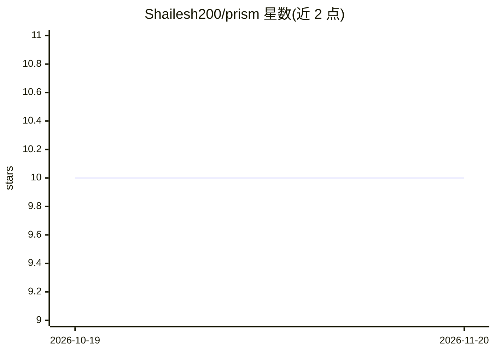

# Shailesh200/prism

⭐ 10 · TypeScript · MIT · 推送 2026-10-19 · [GitHub](https://github.com/Shailesh200/prism) · [官网](https://www.prismhq.in/) · 个人维护

**为编码 agent 提供本地软件智能的 CLI/MCP 工具**

Prism 以 MCP 服务器与 CLI 形式接入编码 agent：编辑前给出任务相关文件与可复用辅助函数，编辑中提示仓库内可参考代码，编辑后由 Dev/Architect/QA 三种 lens 审查遗漏调用方与未覆盖测试，agent 停止时运行受影响检查并给出 SHIP/NOT PROVEN/NO-SHIP 结论。基于本地索引运行于用户机器，分析阶段无网络请求，不产生账户。通过 npm 全局安装，`prism install all` 自动连接检测到的 agent，也提供 MCP server 手工配置。

## 筛选速览

| 维度 | 判定 | 备注 |
|---|---|---|
| AI 角色 | `ai-ecosystem` | LLM/agent 周边工具 |
| 许可风险 | `permissive` | MIT |
| 部署形态 | `library` | 以包/库形式分发 |
| 模型依赖 | — | README 未给出锁定关系 |
| 硬件要求 | — | 无带数字的原话,不猜 |
| 安装摩擦 | `low` | 无编译、无系统依赖或容器化 |
| 成熟度 | — | 结构信号不足 |

## 能力要点

- 九个默认 MCP 工具，可用自然语言触发（如 blast_radius、test_impact、guard_session）
- stop receipt 机制在 agent 停止时运行检查并给出单一裁决
- 可自定义 review lens 与保存例程（habits）
- 本地索引运行，分析无网络请求，可用环境变量关闭每日更新检查

## 适用场景

- 让编码 agent 修改代码前了解影响面与可复用代码
- agent 提交变更后自动审查遗漏与测试覆盖
- 不联网环境下做本地代码影响分析

## 场景标签

`代码审查` · 领域:编码与开发

## 证据(README 行号)

> L11: Local software intelligence that catches what the agent missed. Prism gives
> L53: Nine default MCP tools; more are opt-in through `extraTools` in

## 星数曲线

2026-10-19 10 → 2026-11-20 10（+0）

---
*卡片 v1 · prompt 1.4 · 生成 2026-11-20 · 置信度 high · 依据 README sha `528038766c98` · [字段定义](../../DATASET.md)*
