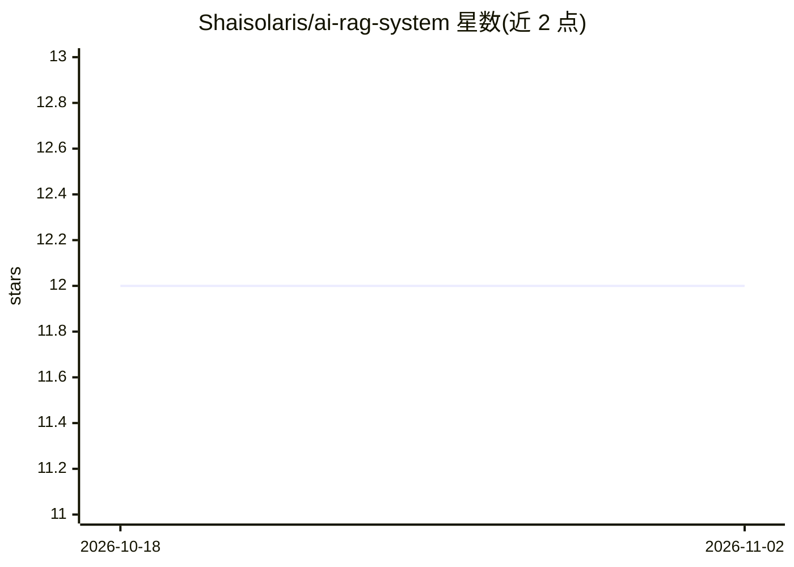

# Shaisolaris/ai-rag-system

⭐ 12 · Python · MIT · 推送 2026-04-07 · [GitHub](https://github.com/Shaisolaris/ai-rag-system) · 个人维护

**面向开发者的 RAG 系统：文档分块、向量检索与 GPT-4o 生成**

实现完整 RAG 流水线：文档摄取（PDF、Markdown、纯文本）后按 token、段落或标题三种策略分块，用 OpenAI text-embedding-3-small 生成嵌入，存入内存向量库并以 numpy 余弦相似度检索，调用 GPT-4o 生成带来源归属的回答。通过 FastAPI 提供 /ingest、/query、/retrieve 等端点，支持 top-k 与相似度阈值配置、多轮对话记忆；提供无需 API key 的 mock 模式用于演示。需设置 OPENAI_API_KEY 运行。

## 筛选速览

| 维度 | 判定 | 备注 |
|---|---|---|
| AI 角色 | `ai-native` | 本体是模型或模型工具 |
| 许可风险 | `permissive` | MIT |
| 部署形态 | `library` | 以包/库形式分发 |
| 模型依赖 | — | README 未给出锁定关系 |
| 硬件要求 | — | 无带数字的原话,不猜 |
| 安装摩擦 | `low` | 无编译、无系统依赖或容器化 |
| 成熟度 | — | 结构信号不足 |

## 能力要点

- token/段落/标题三种文档分块策略
- 内存向量库 + numpy 余弦相似度检索
- GPT-4o 生成回答并附来源归属
- FastAPI 端点：摄取、查询、检索、健康检查

## 适用场景

- 搭建文档问答 API 服务，回答附带出处
- 对比不同分块与检索策略对 RAG 效果的影响
- 无需 OpenAI key 先用 mock 模式跑通演示

## 场景标签

`RAG` · 领域:知识与检索

## 证据(README 行号)

> L5: Retrieval-Augmented Generation system with document chunking (token-based, paragraph-based, header-based), OpenAI em
> L18: |POST|`/query`|RAG: retrieve + generate answer with sources|

## 星数曲线

2026-10-18 12 → 2026-11-02 12（+0）

---
*卡片 v1 · prompt 1.4 · 生成 2026-11-01 · 置信度 mid · 依据 README sha `55b67216aadd` · [字段定义](../../DATASET.md)*
