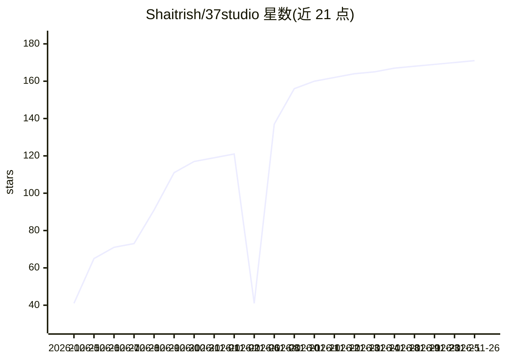

# Shaitrish/37studio

⭐ 171 · Go · MIT · 推送 2026-11-22 · [GitHub](https://github.com/Shaitrish/37studio) · [官网](https://studio.shaitrish.com) · 个人维护 · 中文 README

**自托管 AI 视频工作室：生成视频并发布到 9 平台、起草回复**

37Studio 是一个开源（MIT）视频创作与社媒管理应用：用户给出简报，编辑 agent 在本地以 HyperFrames 组合构建视频，可发布到 9 个平台并起草评论/私信回复。支持从网站或文件夹建立品牌素材库与设计系统，本地 faster-whisper 转写长视频并切分为多段短视频。可自选 agent 运行时（Claude Code、Codex、OpenCode）并自备 API key，通过 MCP 服务器暴露全部界面功能。提供 Windows/Linux 桌面安装包与 Docker 部署，无月费、数据不发送给作者。

## 筛选速览

| 维度 | 判定 | 备注 |
|---|---|---|
| AI 角色 | `ai-native` | 本体是模型或模型工具 |
| 许可风险 | `permissive` | MIT |
| 部署形态 | `library` | 以包/库形式分发 |
| 模型依赖 | locked-api |  |
| 硬件要求 | — | 无带数字的原话,不猜 |
| 安装摩擦 | `medium` | 含编译或系统依赖之一 |
| 成熟度 | — | 结构信号不足 |

## 能力要点

- 编辑 agent 生成 HyperFrames 动画视频并自检帧与节奏
- 发布到 Facebook/Instagram/YouTube/TikTok/LinkedIn/X/Pinterest/Bluesky/Mastodon 九个平台
- 本地 faster-whisper 转写约 100 种语言，长录音切分为多条 reels
- MCP 服务器使外部 agent（Claude Code、Claude Desktop、Cursor）可操控全应用

## 适用场景

- 按品牌自动批量制作短视频并定时发布
- 把两小时课程录像切成十条 reels
- 统一收件箱用客户语言起草评论与私信回复
- 在自有服务器上以自己的 API key 运行，不付月费

## 场景标签

`语音识别` `视频生成` · 领域:内容生成

## 证据(README 行号)

> L3:  The open-source AI video studio that also posts your videos and answers your comments.
> L4: Brief a reel, an ad or an explainer. An AI agent builds it in your brand, renders it on your computer, posts it to n
> L114: - **An editor agent.** Claude Opus 5.5 (or Codex, or any model through OpenCode) builds each video as an animated 

## 星数曲线

2026-10-25 41 → 2026-11-26 171（+130）

---
*卡片 v1 · prompt 1.4 · 生成 2026-11-26 · 置信度 high · 依据 README sha `106f6d187791` · [字段定义](../../DATASET.md)*
