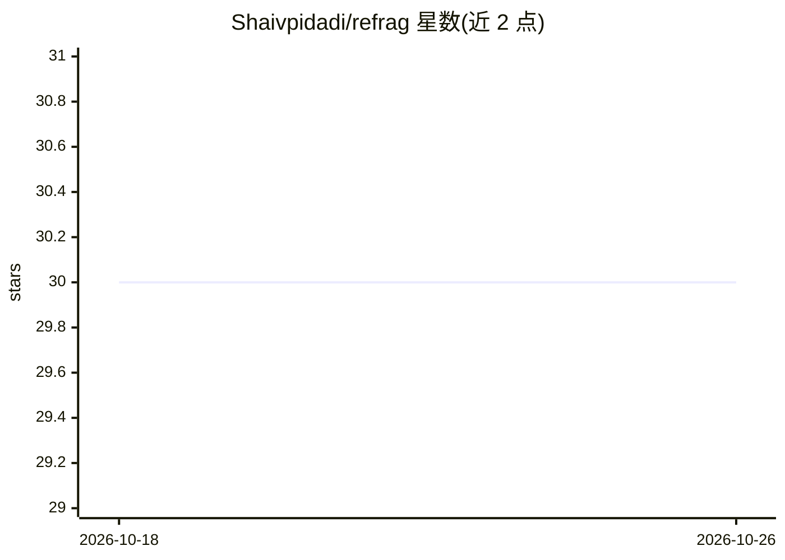

# Shaivpidadi/refrag

⭐ 30 · Python · MIT · 推送 2025-12-29 · [GitHub](https://github.com/Shaivpidadi/refrag) · 个人维护

**RAG 检索优化库：微块切分+查询时压缩降低上下文 token**

REFRAG 论文（arXiv:2509.01092）的独立开源实现，以 Python 库形式提供。核心机制：将文档切分为 16-32 token 微块，索引阶段仅用 sentence-transformers 直接编码（无 LLM 调用），检索时按相关性动态决定每个块输出原文还是压缩为关键词，生成混合上下文以减少发送给 LLM 的 token。模型无关，位于检索与 LLM 生成之间，兼容任意 LLM API。限制：启发式压缩策略（非论文的 RL）、仅英文关键词抽取、向量库仅内存实现。

## 筛选速览

| 维度 | 判定 | 备注 |
|---|---|---|
| AI 角色 | `ai-ecosystem` | LLM/agent 周边工具 |
| 许可风险 | `permissive` | MIT |
| 部署形态 | `library` | 以包/库形式分发 |
| 模型依赖 | — | README 未给出锁定关系 |
| 硬件要求 | — | 无带数字的原话,不猜 |
| 安装摩擦 | `low` | 无编译、无系统依赖或容器化 |
| 成熟度 | — | 结构信号不足 |

## 能力要点

- 16-32 token 微块切分与直接编码索引（无 LLM 调用）
- 查询时压缩：按相关性分数决定 RAW/COMPRESSED 混合上下文
- 模型无关，位于检索与 LLM 之间，无需 API key
- 基于论文 arXiv:2509.01092 的文本空间（Text Space）适配实现

## 适用场景

- 大文档集（1000+ 文档）RAG 系统降低 LLM API token 成本
- 需要细粒度精确检索而非整块返回的场景
- 在不自建 GPU 集群的商用 API 上获得 token 节省

## 场景标签

`RAG` · 领域:知识与检索

## 证据(README 行号)

> L93: REFRAG is **model-agnostic**. It prepares the context *before* it reaches the LLM.
> L104: REFRAG sits **between** retrieval and LLM generation:

## 星数曲线

2026-10-18 30 → 2026-10-26 30（+0）

---
*卡片 v1 · prompt 1.4 · 生成 2026-10-26 · 置信度 mid · 依据 README sha `cda4f30fe7aa` · [字段定义](../../DATASET.md)*
