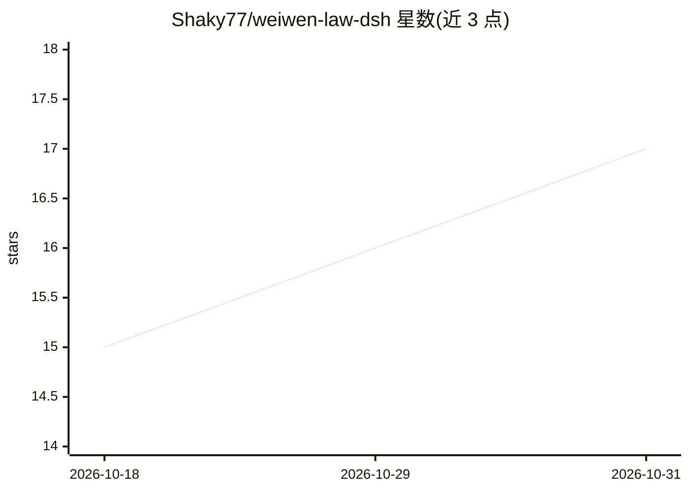

# Shaky77/weiwen-law-dsh

⭐ 17 · JavaScript · AGPL-3.0 · 推送 2026-10-30 · [GitHub](https://github.com/Shaky77/weiwen-law-dsh) · 个人维护 · 中文 README

**给 DeepSeek Harness Agent 挂白箱因果风控的中间件插件**

唯稳律因果引擎的 DSH 插件实现：在 Agent 每次动作前沿 R→S→D→H→M 因果链推演后果，输出 allow/deny/review 三态裁决；通过 3 道硬性闸门（拦动作/拦步/拦回执）与 1 个只读审计钩子实现拦截，注册 12 个白箱自查工具供模型与用户查询。授权面采用任务范围文本与结构化通行证双闸口，宿主侧签发、模型不可自签。插件不写持久状态、不落盘用户数据；框架本体领域无关，对领域内容零知识。dsh 依赖 Node.js ^22.19 或 >=24 与 DeepSeek API Key；验证于 DSH v0.1.x 开发者预览版，API 后续存在破坏性变更风险，生产需锁版本。

## 筛选速览

| 维度 | 判定 | 备注 |
|---|---|---|
| AI 角色 | `ai-ecosystem` | LLM/agent 周边工具 |
| 许可风险 | `viral` | AGPL-3.0 |
| 部署形态 | `library` | 以包/库形式分发 |
| 模型依赖 | locked-api |  |
| 硬件要求 | — | 无带数字的原话,不猜 |
| 安装摩擦 | `low` | 无编译、无系统依赖或容器化 |
| 成熟度 | — | 结构信号不足 |

## 能力要点

- 动作前 R→S→D→H→M 因果链推演，三态裁决 allow/deny/review
- 12 个白箱自查工具 + 3 道硬性闸门 + 1 个只读审计钩子，全部位于模型之外
- 结构化通行证（动作类×作用域×次数/到期）双闸口授权，模型不可自签
- 破窗止损与第一 Bug 停机闭环：断→反推→溯源→修复→重入

## 适用场景

- 给 DSH 上的 AI Agent 加装动作前的因果风控拦截层
- 通过白箱工具审计 Agent 的稳态储备与边界状态
- 用通行证机制约束 Agent 可执行的动作类与作用域范围

## 场景标签

`Agent 框架` · 领域:Agent 开发

## 证据(README 行号)

> L9: **唯稳律通用因果引擎（白箱呈现）** —— 以 **DeepSeek Harness（DSH）** 的 Cordis 插件形态实现。
> L222: 挂载后，运行在该 profile 的 Agent 自动获得 12 个白箱自查工具（`query_iron_laws` / `query_steady_state` / `list_rigid_anchors` / `query_

## 星数曲线

2026-10-18 15 → 2026-10-31 17（+2）

---
*卡片 v1 · prompt 1.4 · 生成 2026-10-30 · 置信度 high · 依据 README sha `9fe96959822a` · [字段定义](../../DATASET.md)*
