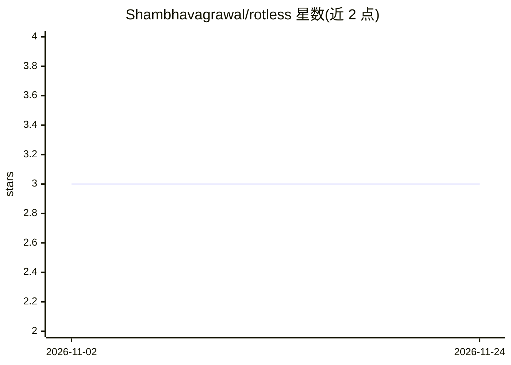

# Shambhavagrawal/rotless

⭐ 3 · Python · MIT · 推送 2026-11-03 · [GitHub](https://github.com/Shambhavagrawal/rotless) · 个人维护

**为 agent 技能提供创建、漂移检测与迭代修复的技能集**

rotless 包含四个遵循开放 Agent Skills 规范的技能：创建前先做 GitHub 等 21+ 来源的已有方案调研；skill-creator 以失败基线、访谈、带/不带技能的对照测试生成 SKILL.md；modernizer 通过 rotless.json 记录依赖的 CLI/API 并检测外部漂移；refiner 将使用中的笔记转化为带失败验证的编辑。面向编写并长期维护 agent 技能的用户，需 Python 3.10+ 与已登录的 GitHub CLI，不适用于一次性 prompt 或他人维护的技能。

## 筛选速览

| 维度 | 判定 | 备注 |
|---|---|---|
| AI 角色 | `ai-ecosystem` | LLM/agent 周边工具 |
| 许可风险 | `permissive` | MIT |
| 部署形态 | `library` | 以包/库形式分发 |
| 模型依赖 | — | README 未给出锁定关系 |
| 硬件要求 | — | 无带数字的原话,不猜 |
| 安装摩擦 | `low` | 无编译、无系统依赖或容器化 |
| 成熟度 | — | 结构信号不足 |

## 能力要点

- 四个技能覆盖调研、创建、漂移检测、迭代改进全流程
- 修复须先在旧版失败、新版通过；优化须同测试集测量更优
- 依赖清单 rotless.json + 覆盖检查标记未覆盖的提及内容
- 纯标准库 Python，无 hooks、后台进程与遥测

## 适用场景

- 为新任务编写 agent 技能前调研已有方案与缺口
- 外部 CLI/API 升级后检测技能内容是否过期
- 把使用中的问题日志转化为带验证的技能修复

## 场景标签

`提示工程` · 领域:Agent 开发

## 证据(README 行号)

> L5:  Agent skills that stay accurate and get better with use.
> L14: **Install (Claude Code):** `/plugin marketplace add Shambhavagrawal/rotless`, then `/plugin install rotless@rotless
> L34: The skills follow the open Agent Skills spec, so any agent that reads `SKILL.md` can load them. Everything is plain

## 星数曲线

2026-11-02 3 → 2026-11-24 3（+0）

---
*卡片 v1 · prompt 1.4 · 生成 2026-11-22 · 置信度 high · 依据 README sha `2f76b9bc695b` · [字段定义](../../DATASET.md)*
