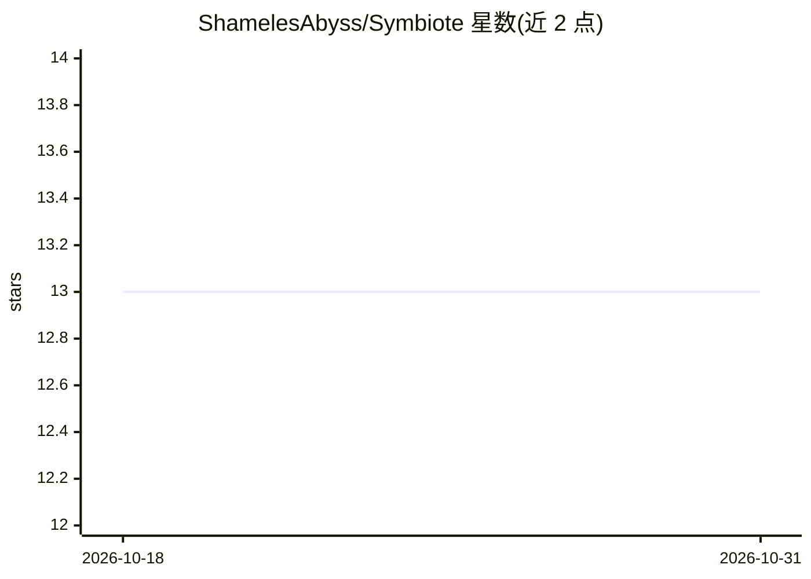

# ShamelesAbyss/Symbiote

⭐ 13 · Rust · MIT · 推送 2026-05-11 · [GitHub](https://github.com/ShamelesAbyss/Symbiote) · 个人维护

**Rust 编写的终端人工生命生态系统模拟器**

纯 Rust 实现的实时终端渲染人工生命模拟：生物经生存、繁殖、迁移与生态压力演化出 11 种生态原型（Grazer/Hunter/Parasite 等），并包含 PatternField 生态记忆场、B3/S23 Conway 风格基质自动机、公理格架演化层、领地强化、根系基础设施生长与长期种群遥测等系统。面向人工生命与涌现行为爱好者，从源码以 Cargo 构建运行，非传统游戏，无脚本化玩法。

## 筛选速览

| 维度 | 判定 | 备注 |
|---|---|---|
| AI 角色 | `ai-enhanced` | 去掉 AI 部分产品仍成立 |
| 许可风险 | `permissive` | MIT |
| 部署形态 | `None` |  |
| 模型依赖 | — | README 未给出锁定关系 |
| 硬件要求 | — | 无带数字的原话,不猜 |
| 安装摩擦 | `medium` | 含编译或系统依赖之一 |
| 成熟度 | — | 结构信号不足 |

## 能力要点

- PatternField 持久生态记忆场影响迁移与领地形成
- B3/S23 Conway 风格基质自动机与公理格架演化层
- 11 种生态原型与谱系继承、灭绝追踪遥测
- 根系层作为地形/墙体类的持久生态基础设施

## 适用场景

- 长时间运行观察涌现的生态结构与物种兴衰
- 研究元胞自动机与生态压力驱动的人工生命系统
- 终端内观看行为优先渲染的生态可视化

## 场景标签

 · 领域:人工生命/模拟

## 证据(README 行号)

> L5:  Rust Powered Terminal Artificial Life SIM
> L130: Symbiote includes Conway-inspired propagation systems integrated directly into substrate ecology.
> L288: ### Artificial Life Simulation

## 星数曲线

2026-10-18 13 → 2026-10-31 13（+0）

---
*卡片 v1 · prompt 1.4 · 生成 2026-10-31 · 置信度 mid · 依据 README sha `06ebacbf8f26` · [字段定义](../../DATASET.md)*
