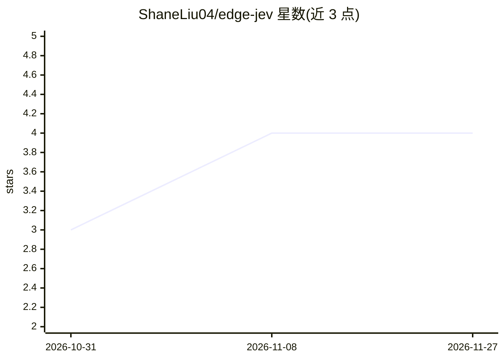

# ShaneLiu04/edge-jev

⭐ 4 · Python · 推送 2026-11-08 · [GitHub](https://github.com/ShaneLiu04/edge-jev) · 个人维护 · 中文 README

**端侧全本地快慢双系统级联路由推理运行时**

面向端侧/本地部署的 LLM 推理运行时：以 ONNX 小模型作 System 1、llama-server 承载 Qwen GGUF 作 System 2，提供 18 个声明式决策点与 direct/light/full 三路径级联路由，支持确定性快答（GEXA 抽取、GQRA 数值推理，命中时不调用 LLM）、前缀 KV 与会话亲和复用、双脑接地验证与升级、KV 快照与多槽并发调度。通过 FastAPI 双协议（含 OpenAI 兼容端点）、Python SDK、CLI 与 MCP Server 对外提供，用 uv 安装并经 jev fetch 拉取模型资产；7B/14B 服务器档仅给配置未实测。

## 筛选速览

| 维度 | 判定 | 备注 |
|---|---|---|
| AI 角色 | `ai-ecosystem` | LLM/agent 周边工具 |
| 许可风险 | `permissive` | — |
| 部署形态 | `None` |  |
| 模型依赖 | local-ok | 支持本地模型 |
| 硬件要求 | `cpu-ok` | |
| 安装摩擦 | `low` | 无编译、无系统依赖或容器化 |
| 成熟度 | — | 结构信号不足 |

## 能力要点

- 级联路由：18 个决策点、direct/light/full 三路径，响应头输出路由元信息
- 零大脑快答：GEXA 单事实抽取与 GQRA 数值推理命中时不调用 LLM
- 前缀 KV + 会话亲和 + 稳定压缩 + 持久化 KV 快照（单槽 PPKS / 多槽 MSPP）
- 双脑接地：0.5B 先答、确定性证据验证通过才接受，否则升级 1.5B

## 适用场景

- 在本地 GPU/CPU 机器上部署全离线的 LLM 服务
- 为端侧助手配置快慢协同与级联降级策略
- 复现并评测级联缓存/压缩等优化的真实收益

## 场景标签

`推理引擎` · 领域:训练与推理

## 证据(README 行号)

> L1: Jev — 端侧快慢双系统 AI 运行时
> L5: > **System 1（小脑）+ System 2（大脑）** 的全本地双系统运行时：类型化决策、级联路由、风险可控降级、前缀/KV 复用、稳定压缩、双脑接地、确定性快答与可复现实验矩阵。
> L16: 大多数「小模型 + 大模型」方案停留在**云端路由**或**单点缓存**。Jev 把「何时不用大模型、用什么上下文、能否复用 KV、结果能否复用、并发如何调度」做成一个**可校准、可回退、可复现的运行时**。

## 星数曲线

2026-10-31 3 → 2026-11-27 4（+1）

---
*卡片 v1 · prompt 1.4 · 生成 2026-11-21 · 置信度 mid · 依据 README sha `7034395def98` · [字段定义](../../DATASET.md)*
