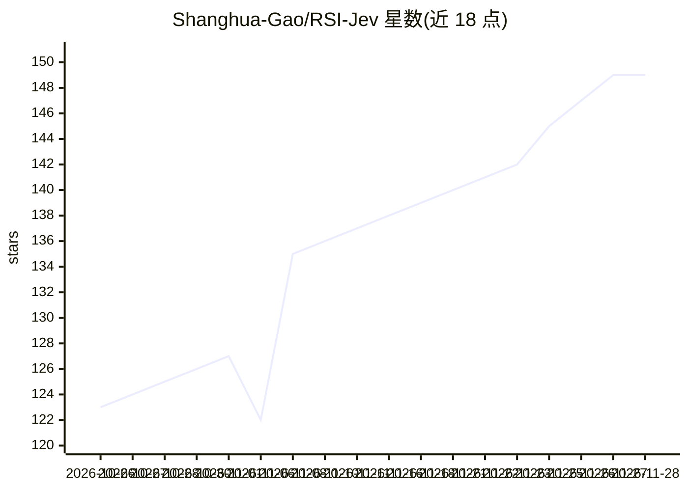

# Shanghua-Gao/RSI-Jev

⭐ 149 · HTML · MIT · 推送 2026-11-20 · [GitHub](https://github.com/Shanghua-Gao/RSI-Jev) · [官网](https://shgao.site) · 个人维护

**AI agent 自改进循环训练的类型化决策模型库（决策打分/判断）**

项目训练并发布一组回答是/否、k 选一、按规则打分类问题的决策模型（noul/choice/score），单次前向返回每个选项的校准概率，不生成文本。模型支持文本与图像输入，并提供 effort 分级（层 16/20/32 早退）以在延迟与深度间取舍。训练由 AI agent 提出假设、预先注册预测、运行实验并按证据更换冠军模型的循环驱动，全部 9 个版本（含失败实验）随代码与 checkpoint 公开。模型以 Qwen3.5/3.8 为基座微调，服务端兼容 Jev API，MIT 代码、Apache-2.0 权重。

## 筛选速览

| 维度 | 判定 | 备注 |
|---|---|---|
| AI 角色 | `ai-native` | 本体是模型或模型工具 |
| 许可风险 | `permissive` | MIT |
| 部署形态 | `library` | 以包/库形式分发 |
| 模型依赖 | — | README 未给出锁定关系 |
| 硬件要求 | — | 无带数字的原话,不猜 |
| 安装摩擦 | `medium` | 含编译或系统依赖之一 |
| 成熟度 | — | 结构信号不足 |

## 能力要点

- 单次前向输出各选项校准概率，无生成式推理 token 开销
- effort 分级早退（层 16/20/32）按问题难度调节深度
- AI agent 自改进循环：9 版本、801 个实验（含失败）全部公开
- 服务端兼容 Jev API，现有 Jev 客户端可直接指向使用

## 适用场景

- 对文档、对话或图片做判断、分类与规则打分
- 低延迟意图识别与请求路由
- 作为 Jev API 兼容的决策服务接入现有客户端

## 场景标签

 · 领域:机器学习模型/决策系统

## 证据(README 行号)

> L32: Models that answer a yes/no, pick-one-of-*k* or rate-on-a-rubric question about a document, a chat
> L34: generated, so there are no reasoning tokens to spend.
> L89: The server speaks Jev's API, so an existing Jev client works once its base URL points here. Every

## 星数曲线

2026-10-26 123 → 2026-11-28 149（+26）

---
*卡片 v1 · prompt 1.4 · 生成 2026-11-27 · 置信度 high · 依据 README sha `8d94394fec3f` · [字段定义](../../DATASET.md)*
