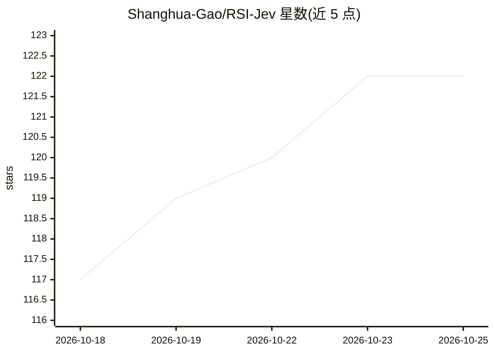

# Shanghua-Gao/RSI-Jev

⭐ 122 · HTML · MIT · 推送 2026-10-10 · [GitHub](https://github.com/Shanghua-Gao/RSI-Jev) · [官网](https://shgao.site) · 个人维护

**AI 自我改进研究循环产出的类型化决策模型及全部实验记录**

RSI-Jev 是一个递归自我改进的研究循环项目：AI agent 提出假设、预注册预测、运行实验并在证据不支持时淘汰自己的冠军模型，产出 Jev 风格的 System One 决策模型（noul/choice/score 三类：是非、多选一、按量表评分），单次前向返回各选项的校准概率，不生成推理 token。模型支持文本与图像输入，通过 effort 参数在多个早期退出层（16/20/32）间选择深度；提供 pip 安装、本地 serve 服务与 Python API，服务端兼容 Jev 的 API。13 天内发布 8 个版本，496 个实验（含失败）全部公开。4B/27B 模型分别基于 Qwen3.5-4B-Base 与 Qwen3.8-27B 微调；27B 需 96GB GPU，4B 提供 Apple silicon 的 MLX 构建。

## 筛选速览

| 维度 | 判定 | 备注 |
|---|---|---|
| AI 角色 | `ai-native` | 本体是模型或模型工具 |
| 许可风险 | `permissive` | MIT |
| 部署形态 | `library` | 以包/库形式分发 |
| 模型依赖 | — | README 未给出锁定关系 |
| 硬件要求 | — | 无带数字的原话,不猜 |
| 安装摩擦 | `medium` | 含编译或系统依赖之一 |
| 成熟度 | — | 结构信号不足 |

## 能力要点

- noul/choice/score 三类类型化决策，单次前向返回校准概率，无生成 token
- effort 机制在层 16/20/32 间按问题难度选择深度（23-40ms 中位延迟）
- AI agent 循环自主提假设、跑实验、淘汰模型，496 个实验含失败全部公开
- pip 安装、rsi-jev serve 本地服务，服务端兼容 Jev API

## 适用场景

- 对文档、对话或图像做是非/多选/量表决策（如缺陷检测、意图判断、内容审核）
- 替代生成式模型做低延迟分类与判断路由，无需推理 token 开销
- 研究递归自我改进实验方法与完整实验记录（EXPLORE.md）

## 场景标签

`多模态` · 领域:感知与多模态

## 证据(README 行号)

> L17: AI agents propose the hypotheses, register their predictions before spending GPU time, run the
> L31: Models that answer a yes/no, pick-one-of-*k* or rate-on-a-rubric question about a document, a chat
> L32: or an image. One forward pass returns a calibrated probability for every option. Nothing is

## 星数曲线

2026-10-18 117 → 2026-10-25 122（+5）

---
*卡片 v1 · prompt 1.4 · 生成 2026-10-23 · 置信度 high · 依据 README sha `13a920e6d823` · [字段定义](../../DATASET.md)*
