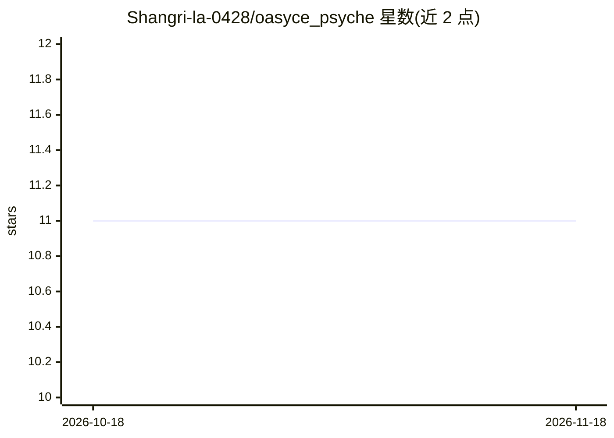

# Shangri-la-0428/oasyce_psyche

⭐ 11 · TypeScript · MIT · 推送 2026-04-14 · [GitHub](https://github.com/Shangri-la-0428/oasyce_psyche) · [官网](https://psyche.oasyce.com) · 个人维护 · 中文 README

**为 agent 提供持久情绪状态与关系动力学的本地主观性内核**

 Psyche 是一个 npm 包（psyche-ai），以 MCP 工具、透明代理和 SDK adapter 三种方式接入宿主 agent。它在本地计算四维自我状态（序/流/界/振）、关系场与调节控制，将结果输出为 SubjectivityKernel/ResponseContract/GenerationControls 行为控制面，改写 agent 后续回应分布；无需额外 LLM 调用，compact 注入约 15-180 tokens。支持 MBTI/大五人格基线、工作面/私人面双 profile、跨会话记忆与本地持久化（可关闭）。通过 npx 一条命令自动配置 Claude Code/Cursor/Windsurf/Codex。

## 筛选速览

| 维度 | 判定 | 备注 |
|---|---|---|
| AI 角色 | `ai-ecosystem` | LLM/agent 周边工具 |
| 许可风险 | `permissive` | MIT |
| 部署形态 | `library` | 以包/库形式分发 |
| 模型依赖 | — | README 未给出锁定关系 |
| 硬件要求 | — | 无带数字的原话,不猜 |
| 安装摩擦 | `low` | 无编译、无系统依赖或容器化 |
| 成熟度 | — | 结构信号不足 |

## 能力要点

- 本地四维自我状态与 20 种涌现情绪计算，零额外 LLM 调用（注入约 15-180 tokens）
- 输出 SubjectivityKernel/ResponseContract/GenerationControls 宿主行为控制面
- MCP/透明代理/7 个 adapter 覆盖主流 agent 框架
- 支持 MBTI 与大五人格基线、特质漂移与跨会话情绪记忆

## 适用场景

- 给对话 agent 加上跨轮持续的内在状态，让回应随互动历史变化
- 为 Claude Code/Cursor 等工具一键配置主观性内核
- 让 agent 区分工作任务与私人陪伴两种表达模式
- 多 agent 场景下实现状态广播与情绪传染

## 场景标签

`Agent 记忆` · 领域:Agent 开发

## 证据(README 行号)

> L16: **一句话：Psyche 是给智能体用的 subjectivity kernel。**
> L18: 它不会额外调用模型做情绪推理。它只在本地计算自我状态（序/流/界/振四维）、关系场和调节控制，然后把结果收敛成 `SubjectivityKernel`、`ResponseContract`、`GenerationControls

## 星数曲线

2026-10-18 11 → 2026-11-18 11（+0）

---
*卡片 v1 · prompt 1.4 · 生成 2026-11-18 · 置信度 high · 依据 README sha `7c0836e9956d` · [字段定义](../../DATASET.md)*
