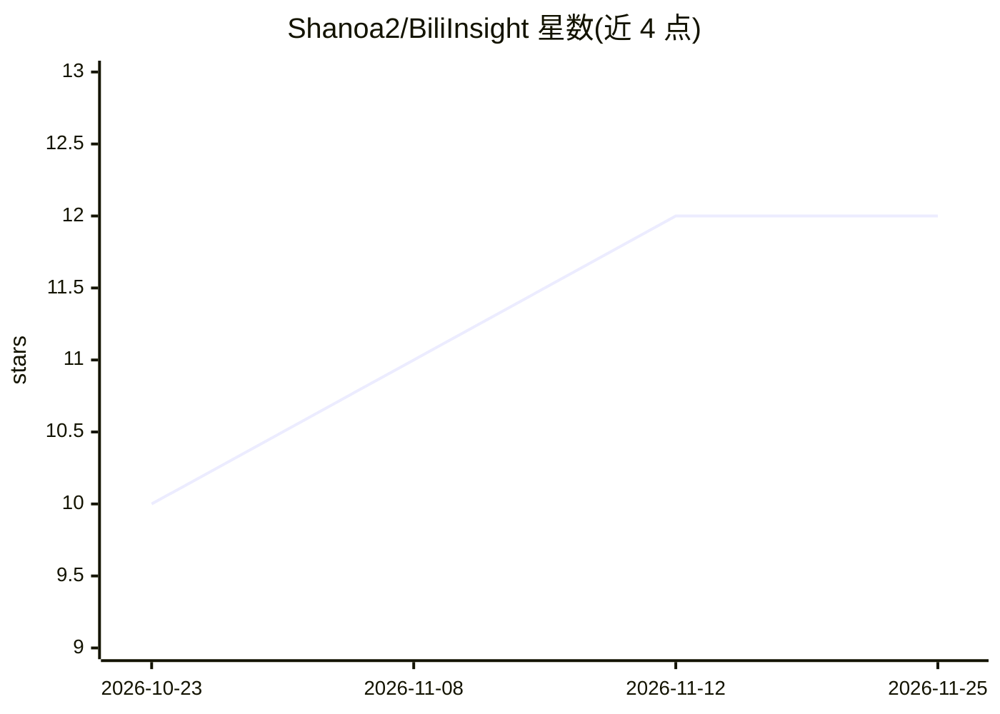

# Shanoa2/BiliInsight

⭐ 12 · Python · GPL-3.0 · 推送 2026-07-10 · [GitHub](https://github.com/Shanoa2/BiliInsight) · 个人维护 · 中文 README

**B 站评论区视频问答 Agent：@机器人即可提问任意视频**

基于 Claude Agent SDK 构建的 B 站视频问答与分析系统，在视频评论区 @ 机器人账号即可提问。Agent 拥有 30+ MCP 本地化工具（字幕、关键帧截图、弹幕、B 站搜索、网页搜索），自主推理决定调用链，支持画面视觉分析与楼中楼追问。模型侧经 LiteLLM 路由，可切换 Gemini/Claude/GPT-4o 等后端。部署面向 Ubuntu/Debian 提供一键脚本并创建 systemd 服务，其他系统可手动克隆构建；使用需配置 B 站登录及各模型 API Key。

## 筛选速览

| 维度 | 判定 | 备注 |
|---|---|---|
| AI 角色 | `ai-native` | 本体是模型或模型工具 |
| 许可风险 | `viral` | GPL-3.0 |
| 部署形态 | `None` |  |
| 模型依赖 | locked-api |  |
| 硬件要求 | — | 无带数字的原话,不猜 |
| 安装摩擦 | `low` | 无编译、无系统依赖或容器化 |
| 成熟度 | — | 结构信号不足 |

## 能力要点

- 基于 Claude Agent SDK，30+ MCP 本地化工具按需调用
- 多模态画面理解：定位时间点拉取关键帧并调用视觉模型分析
- LiteLLM 统一路由，Gemini/Claude/GPT-4o 等模型可切换
- 评论区自动化回复与楼中楼追问

## 适用场景

- 在 B 站评论区向机器人提问视频内容细节
- 让 AI 总结长视频或分析弹幕热梗来源
- 基于浏览历史生成个人观看洞察

## 场景标签

`聊天机器人` `多模态` · 领域:对话与助手

## 证据(README 行号)

> L9: 你可以在任意 B 站视频评论区 @MioriaAI（官方演示账号），向它询问关于这个视频的**任何问题**。它会像人类助理一样，自主决定该使用哪些工具（查字幕、调画面、看弹幕、上网搜）来给你最精准的答案。
> L13: - **原生的 Agent 架构：** 抛弃传统的”全量拼接字幕给大模型”的简单封装模式。基于 Claude Agent SDK 构建，拥有 30+ MCP 本地化工具，模型完全依靠逻辑推理**按需调用**。

## 星数曲线

2026-10-23 10 → 2026-11-25 12（+2）

---
*卡片 v1 · prompt 1.4 · 生成 2026-11-18 · 置信度 high · 依据 README sha `bf9aad409b56` · [字段定义](../../DATASET.md)*
