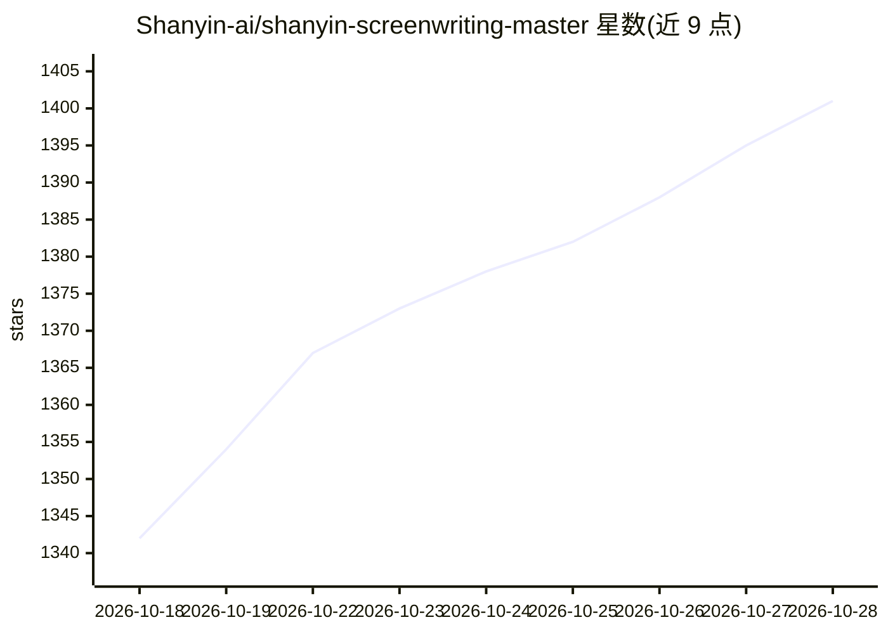

# Shanyin-ai/shanyin-screenwriting-master

⭐ 1,407 · MIT · 推送 2026-04-01 · [GitHub](https://github.com/Shanyin-ai/shanyin-screenwriting-master) · 个人维护 · 中文 README

**面向 Claude 等 AI 工具的全格式影视编剧 Skill**

由 @山音 设计的自然语言驱动编剧 Agent Skill，以 .skill 文件形式导入 Claude（或其他支持 .skill/.zip 的 AI 工具）使用，也可将集成版 .md 拖入 Gemini 等工具的对话框。覆盖概念超短片（how-to-tell/what-if）、5-10 分钟叙事短片、90 分钟长片（商业/文艺双轨）与多集剧集四种格式，流程包含人物设计、结构大纲、场景拆解与标准格式完整剧本。MIT 协议开源，但禁止二次售卖 Skill 本身。

## 筛选速览

| 维度 | 判定 | 备注 |
|---|---|---|
| AI 角色 | `ai-native` | 本体是模型或模型工具 |
| 许可风险 | `permissive` | MIT |
| 部署形态 | `None` |  |
| 模型依赖 | — | README 未给出锁定关系 |
| 硬件要求 | — | 无带数字的原话,不猜 |
| 安装摩擦 | `low` | 无编译、无系统依赖或容器化 |
| 成熟度 | — | 结构信号不足 |

## 能力要点

- 四种剧本格式：概念超短片、叙事短片、90 分钟长片、多集剧集
- 全流程覆盖：人物设计、结构大纲、场景拆解、完整剧本
- .skill 文件直接导入 Claude，其他 AI 工具可用集成版 .md
- 支持补充受众、风格标签、平台适配等定制指令

## 适用场景

- 用 Claude 按标准影视格式生成短片或长片剧本
- 为短视频平台或竞赛快速产出 1-10 分钟短片剧本
- 设计多季剧集的全剧大纲与角色成长线

## 场景标签

`AI 写作` · 领域:内容生成

## 证据(README 行号)

> L2: 由 @山音 设计的自然语言驱动编剧 Agent Skill
> L18: 山音超级编剧大师.skill：核心 Skill 文件（自然语言驱动，直接导入 Claude 即可使用）

## 星数曲线

2026-10-18 1,342 → 2026-10-28 1,401（+59）

---
*卡片 v1 · prompt 1.4 · 生成 2026-10-21 · 置信度 high · 依据 README sha `8937179cc7b2` · [字段定义](../../DATASET.md)*
