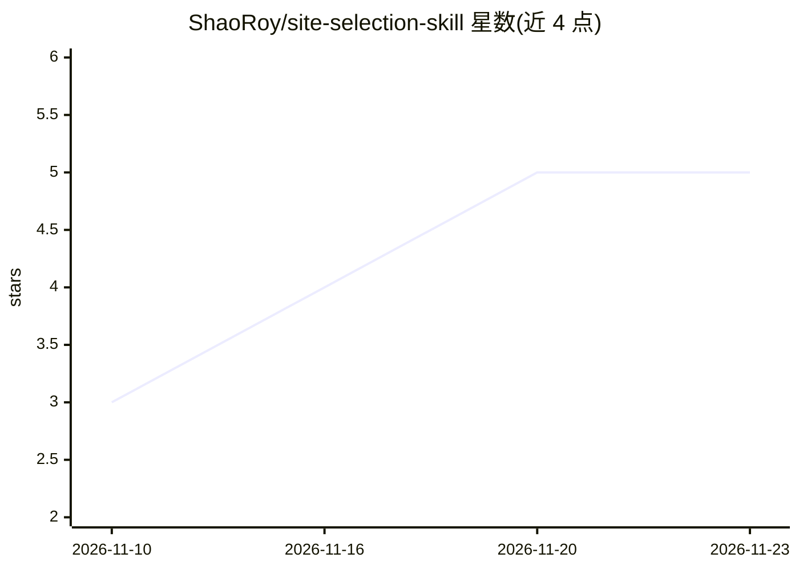

# ShaoRoy/site-selection-skill

⭐ 5 · JavaScript · NOASSERTION · 推送 2026-11-10 · [GitHub](https://github.com/ShaoRoy/site-selection-skill) · [官网](https://shaoroy.github.io/site-selection-skill/) · 个人维护 · 中文 README

**给开店者与 Agent 的门店选址测算技能：商圈/竞品/财务可复核**

以 Agent Skill 形式交付的选址分析工具包，覆盖商圈初选、单点评估、双源校验、财务锁盘四个筛次；核心是一套 Python 计算脚本（site_core.py 纯标准库），数据采集接入高德与腾讯位置服务的个人免费额度，内置 19 城 × 48 餐饮业态基准库。报告为估算性质并声明不做「能不能开」的裁决，每个数字附公式与来源；提供 WorkBuddy 导入与 DeepSeek Harness 两种宿主安装方式，非餐饮业态需自填参数。

## 筛选速览

| 维度 | 判定 | 备注 |
|---|---|---|
| AI 角色 | `ai-enhanced` | 去掉 AI 部分产品仍成立 |
| 许可风险 | `none` | NOASSERTION |
| 部署形态 | `library` | 以包/库形式分发 |
| 模型依赖 | locked-api |  |
| 硬件要求 | — | 无带数字的原话,不猜 |
| 安装摩擦 | `medium` | 含编译或系统依赖之一 |
| 成熟度 | — | 结构信号不足 |

## 能力要点

- 四筛流程：商圈初选→单点评估→腾讯+高德双源校验→财务锁盘
- 证据链报告：每个数字附公式、代入值与来源，附待确认假设台账
- 内置 19 城 × 48 餐饮业态基准库（912 行，行业均值估算）
- 全套 CI 断言 274 条，TS 引擎与 Python 引擎逐字段契约比对

## 适用场景

- 开店前评估一个铺位的保本营业额与极限租金
- 连锁拓展批量扫描网格筛候选点位
- 给 AI Agent 挂载选址分析能力
- 用公开数据替代商用选址平台做商圈分析

## 场景标签

`数据分析` · 领域:效率与自动化

## 证据(README 行号)

> L11: - **AI Agent 开发者**：想给自己的 Agent 挂一个选址能力
> L91: python scripts/site_core.py finance \
> L329: > 也就是说：**装个 Python 3.9 就能跑核心计算**，其余都是可选的。

## 星数曲线

2026-11-10 3 → 2026-11-23 5（+2）

---
*卡片 v1 · prompt 1.4 · 生成 2026-11-21 · 置信度 low · 依据 README sha `e56a8dbbd7b7` · [字段定义](../../DATASET.md)*
