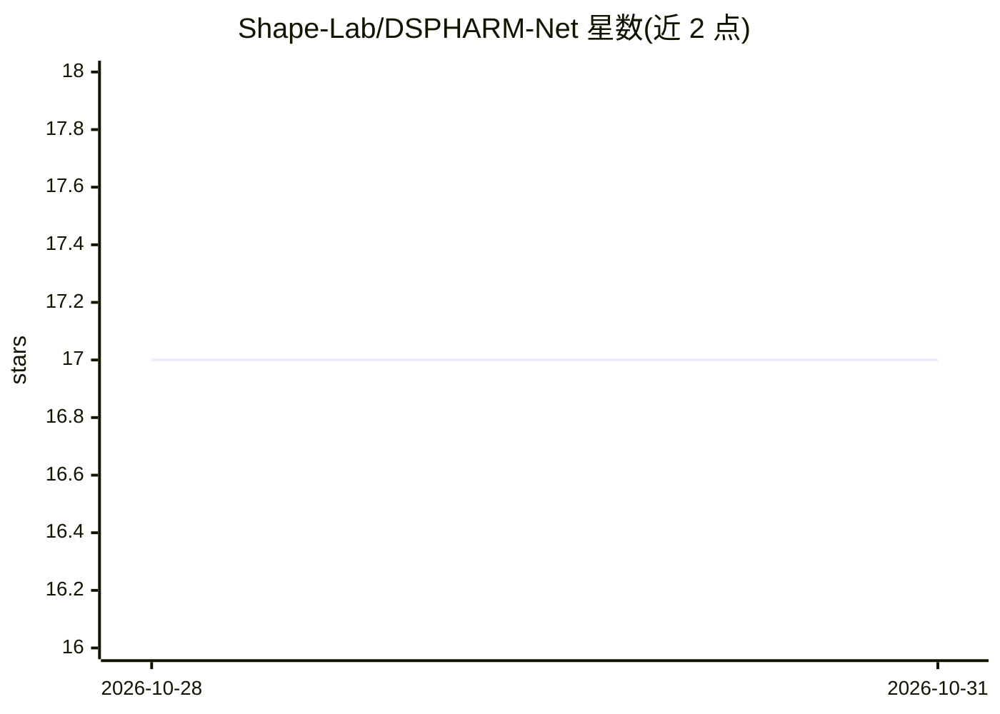

# Shape-Lab/DSPHARM-Net

⭐ 17 · Python · Apache-2.0 · 推送 2026-01-26 · [GitHub](https://github.com/Shape-Lab/DSPHARM-Net) · 组织维护

**脑沟标注的球面 CNN 官方 PyTorch 实现（科研论文代码）**

DSPHARM-Net 是论文 'Leveraging Input-Level Feature Deformation with Guided-Attention for Sulcal Labeling'（IEEE TMI 2024）的官方 PyTorch 实现：在球面上以可变形卷积与引导注意力对皮层表面做脑沟自动标注。提供训练与推理脚本，输入为经刚性配准后的 FreeSurfer 几何特征（curv/sulc/inflated.H），依赖作者提供的二十面体球与 vfids.npy 元数据；实验在 HCP 被试数据上验证，另附预训练 checkpoint（需刚性配准）。面向可复现科研场景，通过 git clone 与 conda 环境安装。

## 筛选速览

| 维度 | 判定 | 备注 |
|---|---|---|
| AI 角色 | `ai-native` | 本体是模型或模型工具 |
| 许可风险 | `permissive` | Apache-2.0 |
| 部署形态 | `None` |  |
| 模型依赖 | — | README 未给出锁定关系 |
| 硬件要求 | — | 无带数字的原话,不猜 |
| 安装摩擦 | `medium` | 含编译或系统依赖之一 |
| 成熟度 | — | 结构信号不足 |

## 能力要点

- 球面可变形卷积与引导注意力的脑沟标注网络
- 提供训练/推理脚本及 k 折交叉验证参数
- 附 HCP 数据验证实验与预训练 checkpoint
- 推理输入为 FreeSurfer 被试目录

## 适用场景

- 对皮层表面数据自动标注脑沟标签
- 复现论文在 HCP 数据上的实验结果
- 基于预训练模型对新被试做脑沟推理

## 场景标签

 · 领域:医学影像/神经科学

## 证据(README 行号)

> L4: This repo is the official PyTorch implementation of **Leveraging Input-Level Feature Deformation with Guided-Attenti
> L31: - `dspharmnet` contains the implementation of the proposed method.

## 星数曲线

2026-10-28 17 → 2026-10-31 17（+0）

---
*卡片 v1 · prompt 1.4 · 生成 2026-10-29 · 置信度 high · 依据 README sha `80bd2d001476` · [字段定义](../../DATASET.md)*
