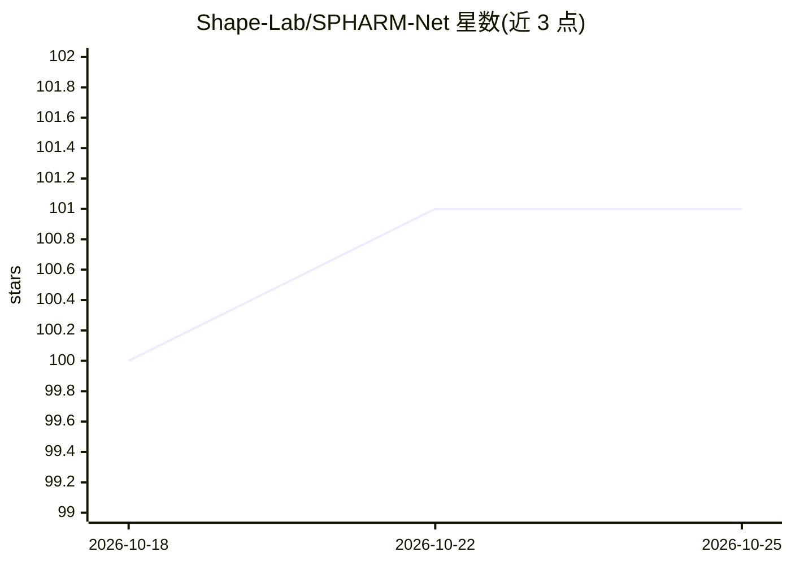

# Shape-Lab/SPHARM-Net

⭐ 101 · Python · Apache-2.0 · 推送 2026-10-09 · [GitHub](https://github.com/Shape-Lab/SPHARM-Net) · [官网](https://doi.org/10.1109/TMI.2022.3168670) · 组织维护

**球谐卷积神经网络：对皮层球面数据做逐顶点分割**

基于球谐函数的旋转等变卷积神经网络，用于球面数据的逐顶点推理（分割）。提出约束型球面卷积滤波器，编码无限谱分量集而无需完整谐波展开，端到端训练不需要刚性数据增强；卷积全部由矩阵变换构成。在 Mindboggle-101 与 NAMIC 两个公开脑皮层分区数据集上测试，也支持扩展到任意球面数据。提供 FreeSurfer 目录结构的数据准备脚本、训练与推理命令，结果可叠加到网格并用 ParaView 可视化。依赖 PyTorch，按 GPU 架构选择 CUDA 版本，GPU 显存消耗因 CUDA 内核而异。

## 筛选速览

| 维度 | 判定 | 备注 |
|---|---|---|
| AI 角色 | `ai-native` | 本体是模型或模型工具 |
| 许可风险 | `permissive` | Apache-2.0 |
| 部署形态 | `library` | 以包/库形式分发 |
| 模型依赖 | — | README 未给出锁定关系 |
| 硬件要求 | — | 无带数字的原话,不猜 |
| 安装摩擦 | `medium` | 含编译或系统依赖之一 |
| 成熟度 | — | 结构信号不足 |

## 能力要点

- 旋转等变球面卷积，无需刚性数据增强即可训练
- 谱卷积由矩阵变换构成，支持无限谱分量集
- 提供数据准备/训练/推理完整脚本流程
- 推理可使用任意球面网格（参考球非必需）

## 适用场景

- 对脑皮层表面做逐顶点分区标注
- 需要旋转等变球面卷积的球面数据分割任务
- 在 Mindboggle-101/NAMIC 数据集上复现实验结果

## 场景标签

`目标检测` `科研工具` · 领域:学习与行业

## 证据(README 行号)

> L4: SPHARM-Net is a spherical harmonics-based convolutional neural network for vertex-wise inference (spherical data seg
> L8: SPHARM-Net seeks (1) a constrained spherical convolutional filter that supports an infinite set of spectral componen

## 星数曲线

2026-10-18 100 → 2026-10-25 101（+1）

---
*卡片 v1 · prompt 1.4 · 生成 2026-10-23 · 置信度 high · 依据 README sha `add2029bdfad` · [字段定义](../../DATASET.md)*
