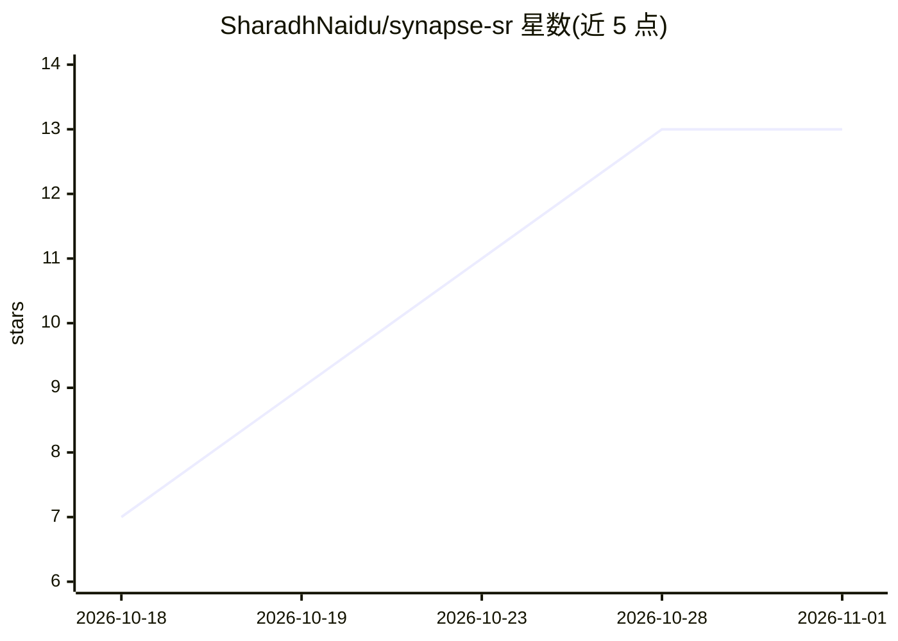

# SharadhNaidu/synapse-sr

⭐ 13 · Python · CC0-1.0 · 推送 2026-10-13 · [GitHub](https://github.com/SharadhNaidu/synapse-sr) · [官网](https://sharadhnaidu.github.io/synapse-sr/) · 个人维护

**Sentinel-2 卫星影像 10m→2m 超分辨率工具，附像素级信任图**

读取 Sentinel-2 L2A 场景，输出 2.0 m 的 RGB+近红外 GeoTIFF（保持原坐标系）。提供两档模型：Flash（约 0.6M 参数 CNN，任意 CPU 约 1 秒处理 1.28 km 场景）与 Pro（14.4M 参数 Mamba，GPU 约 5 秒）。机制上以仪器物理模型约束网络输出，网络不能与观测矛盾，并输出逐像素信任图与校准不确定性。内置 NDVI/SAVI 等指数、变化检测（洪水/烧痕）与 --fetch 按坐标下载。面向遥感和 GIS 开发者/科研用户。

## 筛选速览

| 维度 | 判定 | 备注 |
|---|---|---|
| AI 角色 | `ai-native` | 本体是模型或模型工具 |
| 许可风险 | `viral` | CC0-1.0 |
| 部署形态 | `library` | 以包/库形式分发 |
| 模型依赖 | — | README 未给出锁定关系 |
| 硬件要求 | `cpu-ok` | |
| 安装摩擦 | `medium` | 含编译或系统依赖之一 |
| 成熟度 | — | 结构信号不足 |

## 能力要点

- Flash 档在笔记本 CPU 约 1 秒处理 1.28 km 场景
- 物理一致性约束：网络只能补充 10 m 像素无法显示的成分
- 逐像素信任图与校准的不确定性输出
- 提供 CLI、Python API、Colab/Kaggle notebook 与 Hugging Face 权重

## 适用场景

- 把免费 Sentinel-2 影像增强到 2 m 做农田/城市分析
- 洪水淹没面积与烧痕等双时相变化检测
- 在没有 GPU 的笔记本上离线处理卫星场景

## 场景标签

`图像视频处理` `科研工具` · 领域:学习与行业

## 证据(README 行号)

> L24: **synapse-sr** turns a Sentinel-2 L2A scene into a 2.0 m red / green / blue / near-infrared GeoTIFF. A physical mod
> L35: r = synapse_sr.super_resolve("sentinel2_l2a.tif")   # progress bar, then a 5x larger result
> L95: |Network|~0.6 M-parameter re-parameterised CNN, distilled from Pro|14.4 M-parameter state-space (Mamba) model|

## 星数曲线

2026-10-18 7 → 2026-11-01 13（+6）

---
*卡片 v1 · prompt 1.4 · 生成 2026-10-31 · 置信度 high · 依据 README sha `ad4a04cacd26` · [字段定义](../../DATASET.md)*
