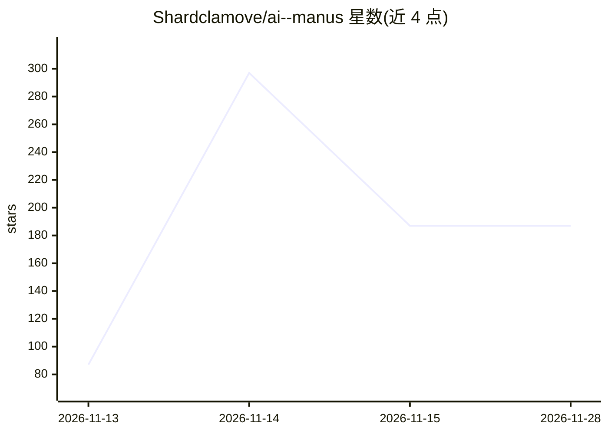

# Shardclamove/ai--manus

⭐ 187 · Apache-2.0 · 推送 2026-11-15 · [GitHub](https://github.com/Shardclamove/ai--manus) · 个人维护

**面向日常任务的自主 AI Agent：可执行代码并控制浏览器**

README 以宣传口吻描述一个名为 Manus 的自主 AI Agent，定位为家庭、学习与轻量办公场景的个人助手：可自主编写并执行脚本、控制浏览器（导航、填表、抓取信息）、执行多步任务，代码与浏览器操作可在同一流程中衔接。README 给出系统兼容性表（最低双核 CPU/4GB 内存）与上手步骤说明，但未提供任何安装命令、代码仓库结构、模型接入方式或 API 配置说明，实际运行机制不可验证。主题标签提及 OpenAI、Anthropic、Gemini、React 等，但正文无对应内容。

## 筛选速览

| 维度 | 判定 | 备注 |
|---|---|---|
| AI 角色 | `ai-native` | 本体是模型或模型工具 |
| 许可风险 | `permissive` | Apache-2.0 |
| 部署形态 | `None` |  |
| 模型依赖 | — | README 未给出锁定关系 |
| 硬件要求 | — | 无带数字的原话,不猜 |
| 安装摩擦 | `low` | 无编译、无系统依赖或容器化 |
| 成熟度 | — | 结构信号不足 |

## 能力要点

- 自主编写并执行脚本完成代码任务
- 浏览器控制：导航、填表、信息采集
- 代码执行与浏览器操作可在同一任务流程中衔接
- 多步任务可在少量监督下执行

## 适用场景

- 让代理代为执行重复的网页操作与信息收集
- 整理研究笔记、运行小脚本等学习场景任务
- 轻量办公中跨多页面汇总信息

## 场景标签

`AI 助手` `浏览器自动化` `编码 Agent` · 领域:效率与自动化

## 证据(README 行号)

> L10: - **Autonomous Code Execution:** Manus AI agent runs code on its own to complete tasks, so you can focus on decisio
> L18: Manus is an autonomous AI agent designed to run code and control a browser on your behalf. Instead of acting like a

## 星数曲线

2026-11-13 87 → 2026-11-28 187（+100）

---
*卡片 v1 · prompt 1.4 · 生成 2026-11-17 · 置信度 mid · 依据 README sha `a3d88e202bf0` · [字段定义](../../DATASET.md)*
