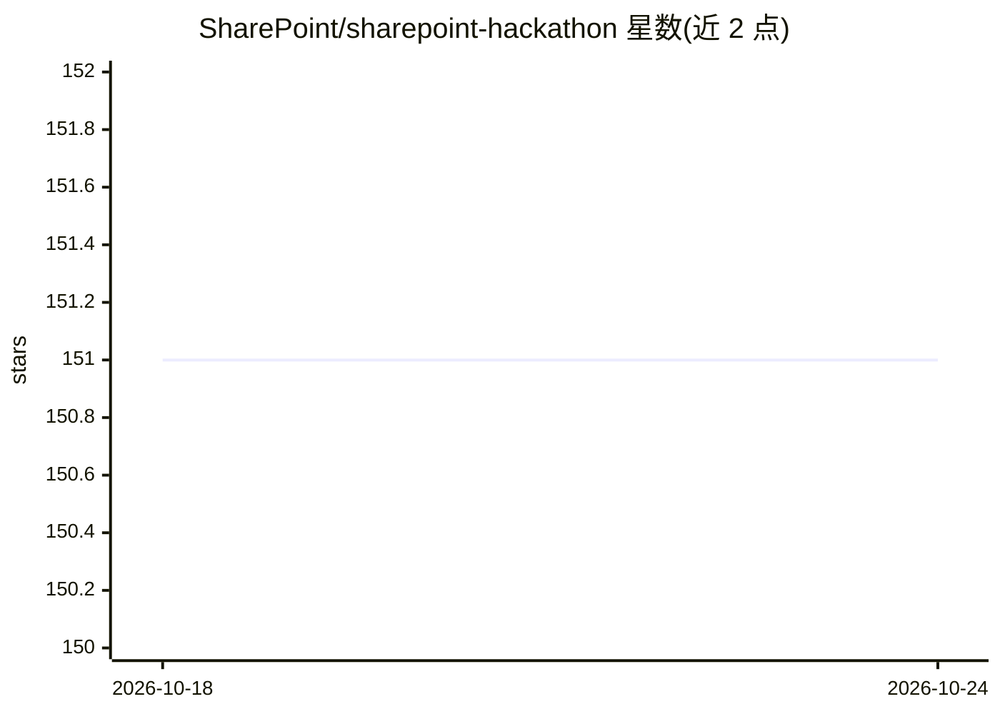

# SharePoint/sharepoint-hackathon

⭐ 151 · MIT · 推送 2026-03-12 · [GitHub](https://github.com/SharePoint/sharepoint-hackathon) · 组织维护

**2026 春季 SharePoint 黑客松活动页面，面向所有人开放参赛**

Microsoft SharePoint 团组发布的黑客松落地页：活动于 2026 年 3 月 2 日至 16 日举行，围绕用 AI 与 SharePoint 新特性（Copilot、agents、SPFx、SharePoint Embedded）构建体验。设 7 个提交类别与特别奖项，提交形式为不超过 8 分钟的视频（通过 GitHub Issue 链接提交），无需预注册，也允许提交已有作品；获奖团队每可获 Surface Laptop，参赛者可获数字徽章。页面还给出直播日程、Office Hours 与 FAQ。

## 筛选速览

| 维度 | 判定 | 备注 |
|---|---|---|
| AI 角色 | `ai-knowledge` | 知识聚合/清单类 |
| 许可风险 | `permissive` | MIT |
| 部署形态 | `None` |  |
| 模型依赖 | — | README 未给出锁定关系 |
| 硬件要求 | — | 无带数字的原话,不猜 |
| 安装摩擦 | `low` | 无编译、无系统依赖或容器化 |
| 成熟度 | — | 结构信号不足 |

## 能力要点

- 7 个提交类别（站点设计、移动体验、Knowledge Agent、AI agents、SPFx、SharePoint Embedded 等）
- 提交形式为视频（≤8 分钟），经 GitHub Issue 链接提交
- 无需预注册，允许提交已有设计或 agent 应用
- 获奖者获 Surface Laptop，参赛提交者获数字徽章

## 适用场景

- 报名参加 SharePoint 黑客松并了解提交规则
- 查看直播日程以了解各提交类别的最新功能
- 合作伙伴提交基于 SharePoint 的产品或 agent 场景

## 场景标签

 · 领域:社区活动/协作平台生态

## 证据(README 行号)

> L3: We are excited to share the SharePoint Hackathon is back in 2026 and will be running from 2nd of March until 16th of
> L13: We are excited to invite you to a **hackathon** dedicated to **crafting engaging experiences using AI and the lates
> L94: * **Best use of SharePoint in AI agents** - Build intelligent agents that use SharePoint as their grounding layer —

## 星数曲线

2026-10-18 151 → 2026-10-24 151（+0）

---
*卡片 v1 · prompt 1.4 · 生成 2026-10-22 · 置信度 mid · 依据 README sha `9560a9e12f0a` · [字段定义](../../DATASET.md)*
