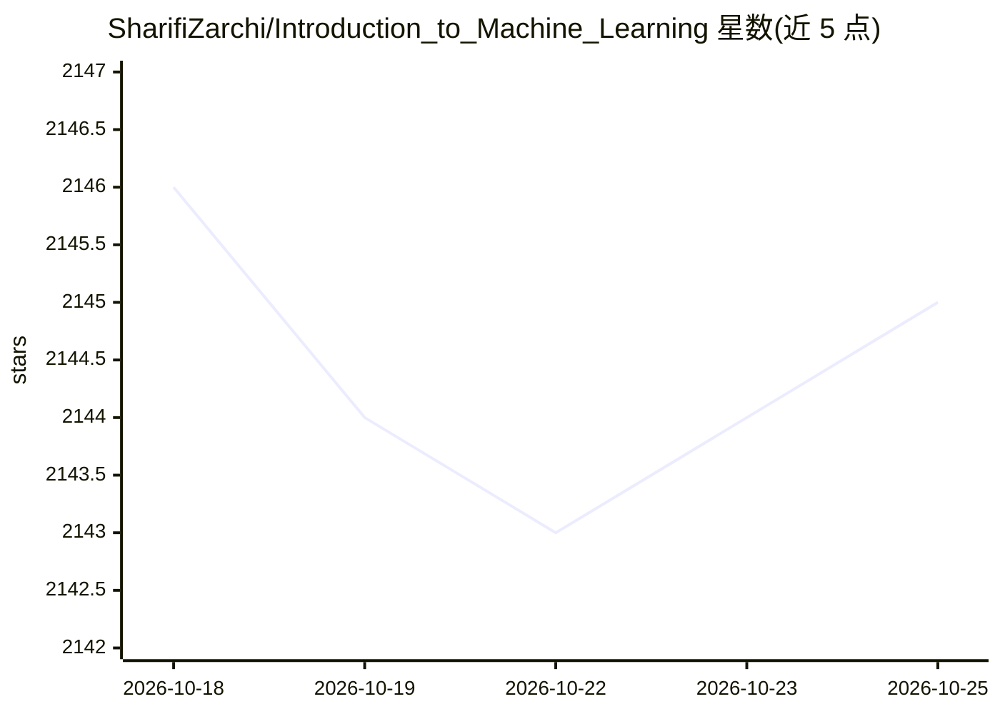

# SharifiZarchi/Introduction_to_Machine_Learning

⭐ 2,145 · Jupyter Notebook · 推送 2026-05-18 · [GitHub](https://github.com/SharifiZarchi/Introduction_to_Machine_Learning) · [官网](https://SharifML.ir) · 组织维护

**谢里夫理工大学机器学习课程：讲义、笔记与练习**

谢里夫理工大学计算机工程系开设的机器学习课程内容仓库，提供课程幻灯片、Jupyter Notebook 与练习题，并收录往学期材料入口；课程视频与补充资源发布于 SharifML 网站（波斯语）。内容按 Creative Commons BY 许可发布，使用者需引用课程与仓库。面向修课学生与自学者，属于教学知识资源而非可安装的软件。

## 筛选速览

| 维度 | 判定 | 备注 |
|---|---|---|
| AI 角色 | `ai-knowledge` | 知识聚合/清单类 |
| 许可风险 | `none` | — |
| 部署形态 | `None` |  |
| 模型依赖 | — | README 未给出锁定关系 |
| 硬件要求 | — | 无带数字的原话,不猜 |
| 安装摩擦 | `low` | 无编译、无系统依赖或容器化 |
| 成熟度 | — | 结构信号不足 |

## 能力要点

- 提供课程幻灯片、Jupyter Notebook 与练习
- 收录 Previous Semesters 往学期课程材料
- 课程视频与补充资源见 SharifML 网站（波斯语）
- Creative Commons BY 许可，需注明引用

## 适用场景

- 系统学习机器学习课程内容
- 获取课程配套 Notebook 与练习题
- 查阅往学期教学材料

## 场景标签

`教程课程` · 领域:学习与行业

## 证据(README 行号)

> L3: Welcome to the "Machine Learning" course of Department of Computer Engineering, Sharif University of Technology.
> L5: You can access slides, Jupyter notebooks, and exercises.

## 星数曲线

2026-10-18 2,146 → 2026-10-25 2,145（-1）

---
*卡片 v1 · prompt 1.4 · 生成 2026-10-21 · 置信度 high · 依据 README sha `77cfecd5e23f` · [字段定义](../../DATASET.md)*
