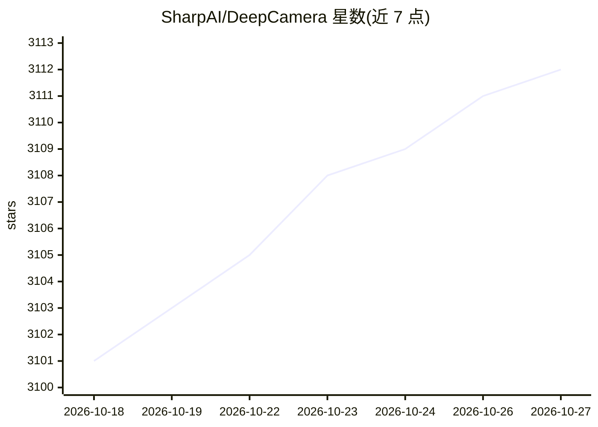

# SharpAI/DeepCamera

⭐ 3,112 · JavaScript · MIT · 推送 2026-09-17 · [GitHub](https://github.com/SharpAI/DeepCamera) · [官网](http://www.sharpai.org) · 组织维护

**开源 AI 摄像头技能平台：本地 VLM/YOLO 视频分析与家庭安防监控**

面向家庭安防场景的 AI 摄像头技能平台：接入 RTSP/ONVIF 摄像头，以可插拔 SKILL.md 技能形式提供目标检测（YOLO26）、人脸识别、行人重识别、车牌识别、SAM2 分割、深度图隐私匿名化等能力，本地运行 Qwen、DeepSeek、SmolVLM、LLaVA 等模型。桌面端 SharpAI Aegis 内置 llama-server 与 LLM 部署代理，自动检测 GPU/NPU 硬件并安装对应框架，经 Telegram/Discord/Slack 对话交互。另有 143 项测试的 HomeSec-Bench 安防基准与 sharpai-cli Docker 旧工作流。

## 筛选速览

| 维度 | 判定 | 备注 |
|---|---|---|
| AI 角色 | `ai-native` | 本体是模型或模型工具 |
| 许可风险 | `permissive` | MIT |
| 部署形态 | `library` | 以包/库形式分发 |
| 模型依赖 | local-ok | 支持本地模型 |
| 硬件要求 | `cpu-ok` | |
| 安装摩擦 | `medium` | 含编译或系统依赖之一 |
| 成熟度 | — | 结构信号不足 |

## 能力要点

- 可插拔技能架构，检测技能统一走 JSONL stdin/stdout 协议
- 自动检测 NVIDIA/AMD/Apple Silicon/Intel/CPU 并转换模型格式（TensorRT/CoreML/OpenVINO/ONNX）
- LLM 代理自主安装技能：读 SKILL.md 清单、探测硬件、安装并验证
- HomeSec-Bench 143 项本地安防基准，含提示注入抵抗与隐私合规测试

## 适用场景

- 给家用摄像头加本地目标检测与 VLM 场景分析，数据不出本机
- 通过 Telegram/Discord/Slack 与摄像头对话，询问事件并获得带录像的回答
- 用深度图匿名化模式监控室内活动而不暴露身份
- 在自己硬件上评测不同本地 VLM 的安防表现

## 场景标签

`目标检测` `人脸识别` `网络安全` `模型评测` · 领域:评测与运维

## 证据(README 行号)

> L3:  DeepCamera's open-source skills give your cameras AI — VLM scene analysis, object detection, person re-identificati
> L25: SharpAI Aegis is the desktop companion for DeepCamera. It uses LLM to automatically set up your environment, config
> L95: - 🤖 **Built-in local LLM & VLM** — llama-server included, no separate setup needed

## 星数曲线

2026-10-18 3,101 → 2026-10-27 3,112（+11）

---
*卡片 v1 · prompt 1.4 · 生成 2026-10-20 · 置信度 mid · 依据 README sha `a9d24b9fc070` · [字段定义](../../DATASET.md)*
