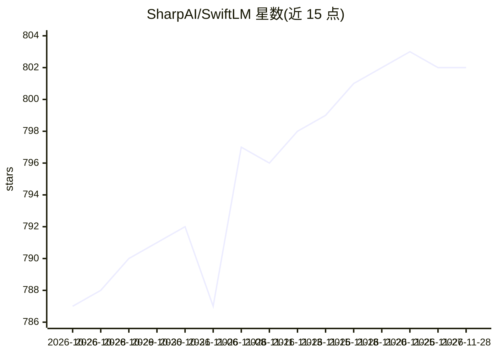

# SharpAI/SwiftLM

⭐ 802 · Swift · MIT · 推送 2026-11-26 · [GitHub](https://github.com/SharpAI/SwiftLM) · 组织维护

**Apple Silicon 原生 MLX Swift LLM 推理服务器，兼容 OpenAI API**

以单一二进制交付的原生 Swift 推理服务器，加载 MLX 格式模型并以严格 OpenAI 兼容 API 对外服务；无 Python 运行时依赖，Metal 内核随发布包捆绑。支持 --stream-experts 从 NVMe SSD 流式读取超大 MoE 专家层、--turbo-kv KV 缓存压缩、--mtp 投机解码等运行选项。README 大篇幅给出 Mac mini M6 32GB 与 M5 Pro 64GB 的基准表及多个已修复的内存问题记录。另有 iOS/iPhone 应用演示。仅面向 Apple Silicon macOS 平台。

## 筛选速览

| 维度 | 判定 | 备注 |
|---|---|---|
| AI 角色 | `ai-ecosystem` | LLM/agent 周边工具 |
| 许可风险 | `permissive` | MIT |
| 部署形态 | `desktop` | 安装包/桌面程序 |
| 模型依赖 | — | README 未给出锁定关系 |
| 硬件要求 | — | 无带数字的原话,不猜 |
| 安装摩擦 | `medium` | 含编译或系统依赖之一 |
| 成熟度 | — | 结构信号不足 |

## 能力要点

- OpenAI 兼容 API 的原生 Swift 推理服务器，编译为单一自包含二进制
- --stream-experts 支持从 SSD 流式运行超大 MoE 模型
- --turbo-kv KV 缓存压缩与 --mtp 投机解码选项
- 附带 iPhone 应用（SwiftBuddy）演示

## 适用场景

- 在 Apple Silicon Mac 上本地部署 MLX 模型并供 OpenAI 兼容客户端调用
- 在 32GB/64GB 统一内存设备上运行超大 MoE 模型
- 对 Swift/MLX 推理路径做基准测试与回归验证

## 场景标签

`推理引擎` · 领域:训练与推理

## 证据(README 行号)

> L3: A blazingly fast, native Swift inference server that serves MLX models with a strict **OpenAI-compatible API**.
> L20: ./SwiftLM --model mlx-community/Qwen2.5-3B-Instruct-4bit --port 5413

## 星数曲线

2026-10-26 787 → 2026-11-28 802（+15）

---
*卡片 v1 · prompt 1.4 · 生成 2026-11-27 · 置信度 high · 依据 README sha `064db8016180` · [字段定义](../../DATASET.md)*
