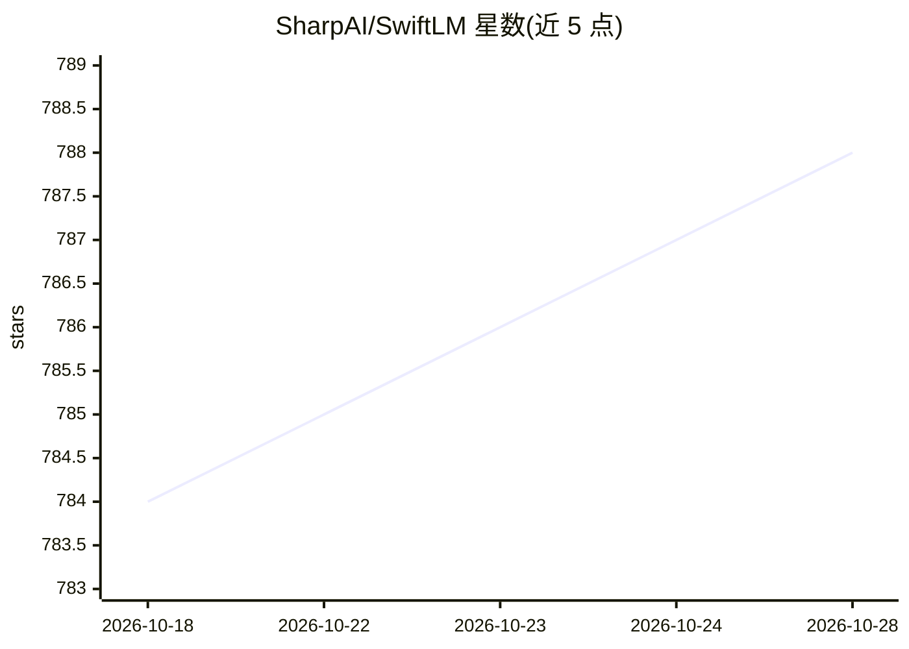

# SharpAI/SwiftLM

⭐ 790 · Swift · MIT · 推送 2026-10-28 · [GitHub](https://github.com/SharpAI/SwiftLM) · 组织维护

**Apple Silicon 上的原生 Swift MLX LLM 推理服务器**

用 Swift 编写的本地推理服务器，加载 MLX 格式模型并通过 OpenAI 兼容 API 提供服务，编译为单二进制、无 Python 运行时。面向 Apple Silicon 用户，支持 MoE 模型的 SSD 专家流式加载（--stream-experts，使 32GB 内存机器可运行大模型）、TurboQuant KV 缓存压缩（--turbo-kv）、MTP 投机解码等。README 提供预编译二进制下载与源码构建两种安装方式，性能数据覆盖 M6/M5 Pro/M1 Ultra 硬件。限制：仅限 Apple Silicon（Metal/Mac），附 iOS 应用演示。

## 筛选速览

| 维度 | 判定 | 备注 |
|---|---|---|
| AI 角色 | `ai-ecosystem` | LLM/agent 周边工具 |
| 许可风险 | `permissive` | MIT |
| 部署形态 | `desktop` | 安装包/桌面程序 |
| 模型依赖 | — | README 未给出锁定关系 |
| 硬件要求 | — | 无带数字的原话,不猜 |
| 安装摩擦 | `medium` | 含编译或系统依赖之一 |
| 成熟度 | — | 结构信号不足 |

## 能力要点

- OpenAI 兼容 API 服务 MLX 模型，单二进制无 Python 运行时
- --stream-experts 从 NVMe SSD 流式加载 MoE 专家层，32GB 内存可跑 26B+ 模型
- TurboQuant KV 缓存压缩（--turbo-kv）与 MTP 投机解码
- 附带 macOS 与 iOS 应用演示

## 适用场景

- 在 Mac 上本地部署 OpenAI 兼容的 LLM API 服务
- 小内存 Apple Silicon 机器运行 100B+ MoE 模型
- 为现有 OpenAI API 客户端提供本地后端

## 场景标签

`推理引擎` · 领域:训练与推理

## 证据(README 行号)

> L3: A blazingly fast, native Swift inference server that serves MLX models with a strict **OpenAI-compatible API**.
> L5: No Python runtime, no Global Interpreter Lock (GIL), no unnecessary memory copies. Just bare-metal Apple Silicon per

## 星数曲线

2026-10-18 784 → 2026-10-28 788（+4）

---
*卡片 v1 · prompt 1.4 · 生成 2026-10-21 · 置信度 high · 依据 README sha `a010692dde32` · [字段定义](../../DATASET.md)*
