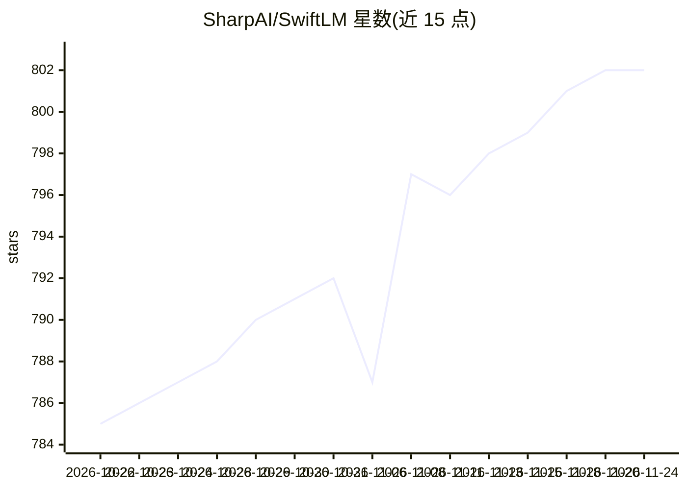

# SharpAI/SwiftLM

⭐ 802 · Swift · MIT · 推送 2026-11-19 · [GitHub](https://github.com/SharpAI/SwiftLM) · 组织维护

**面向 Apple Silicon 的原生 Swift LLM 推理服务器，提供 OpenAI 兼容 API**

以 Swift 编写的 MLX 模型推理服务器，编译为单个二进制文件，无 Python 运行时；对外暴露 OpenAI 兼容 API。支持从 SSD 直接流式读取超大 MoE 模型的专家层（--stream-experts）、TurboQuant KV 缓存压缩（--turbo-kv）、MTP 投机解码与提示缓存。提供 macOS 预编译包、源码构建脚本（cmake + Metal kernel 编译）及 iOS 端 SwiftBuddy 应用。README 附带 M6/M5 Pro 上多款模型的吞吐与显存占用基准。

## 筛选速览

| 维度 | 判定 | 备注 |
|---|---|---|
| AI 角色 | `ai-ecosystem` | LLM/agent 周边工具 |
| 许可风险 | `permissive` | MIT |
| 部署形态 | `desktop` | 安装包/桌面程序 |
| 模型依赖 | — | README 未给出锁定关系 |
| 硬件要求 | — | 无带数字的原话,不猜 |
| 安装摩擦 | `medium` | 含编译或系统依赖之一 |
| 成熟度 | — | 结构信号不足 |

## 能力要点

- 单二进制分发，含捆绑的 mlx.metallib，无需 Python 运行时
- SSD 流式加载（--stream-experts）支持 100B+ MoE 模型
- TurboQuant KV 缓存压缩与 MTP 投机解码
- 提供 iOS 端 SwiftBuddy 应用

## 适用场景

- 在 Mac 上本地运行 LLM 并通过 OpenAI 兼容 API 接入应用
- 在 32GB 统一内存的 Mac 上运行超大 MoE 模型
- 在 iPhone 上进行端侧模型推理

## 场景标签

`推理引擎` · 领域:训练与推理

## 证据(README 行号)

> L3: A blazingly fast, native Swift inference server that serves MLX models with a strict **OpenAI-compatible API**.
> L5: No Python runtime, no Global Interpreter Lock (GIL), no unnecessary memory copies. Just bare-metal Apple Silicon per

## 星数曲线

2026-10-22 785 → 2026-11-24 802（+17）

---
*卡片 v1 · prompt 1.4 · 生成 2026-11-24 · 置信度 high · 依据 README sha `bf3238ecbcaf` · [字段定义](../../DATASET.md)*
