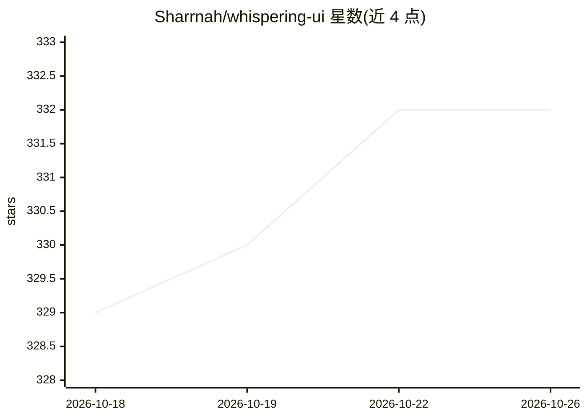

# Sharrnah/whispering-ui

⭐ 332 · Go · MIT · 推送 2026-10-01 · [GitHub](https://github.com/Sharrnah/whispering-ui) · [官网](https://whispering-tiger.github.io/) · 个人维护

**本地实时语音转写/翻译桌面应用（Whispering Tiger 原生 UI）**

Windows/Linux 桌面应用，包含 Go/Fyne 原生 UI 与运行 AI 模型的 Python 后端：转写麦克风或桌面音频、翻译语音与文本、文本转语音、OCR 识别游戏内图像，结果可通过 WebSocket 浏览器覆盖层或 OSC 发送到 VRChat。模型下载后本地离线运行；支持 CPU/CUDA，AMD/Intel 可经 audio.cpp 的 Vulkan 路径。提供插件系统（实时字幕、RVC、LLM 插件等）与配置文件管理，安装方式为下载发布版 ZIP 解压运行。

## 筛选速览

| 维度 | 判定 | 备注 |
|---|---|---|
| AI 角色 | `ai-native` | 本体是模型或模型工具 |
| 许可风险 | `permissive` | MIT |
| 部署形态 | `desktop` | 安装包/桌面程序 |
| 模型依赖 | — | README 未给出锁定关系 |
| 硬件要求 | — | 无带数字的原话,不猜 |
| 安装摩擦 | `medium` | 含编译或系统依赖之一 |
| 成熟度 | — | 结构信号不足 |

## 能力要点

- 本地 AI 处理，模型下载后可离线使用
- CPU/NVIDIA CUDA，AMD/Intel/NVIDIA Vulkan（audio.cpp STT/TTS）
- 桌面音频采集（WASAPI loopback / PulseAudio/PipeWire monitor）
- 插件系统（实时字幕、RVC、LLM、TTS 等插件）

## 适用场景

- 实时转写或翻译麦克风与桌面音频（如游戏、直播音频）
- 将转写/翻译结果发送到 VRChat 或浏览器覆盖层
- 离线文本转语音与图像文字识别（OCR）

## 场景标签

`语音识别` `语音合成` `OCR` · 领域:内容生成

## 证据(README 行号)

> L3: Whispering Tiger is a free, open-source desktop application for **Windows and Linux**. Transcribe microphone or desk
> L7: This repository contains the native Go/Fyne UI. The Python backend runs the AI models.

## 星数曲线

2026-10-18 329 → 2026-10-26 332（+3）

---
*卡片 v1 · prompt 1.4 · 生成 2026-10-21 · 置信度 high · 依据 README sha `7adc55215a9a` · [字段定义](../../DATASET.md)*
