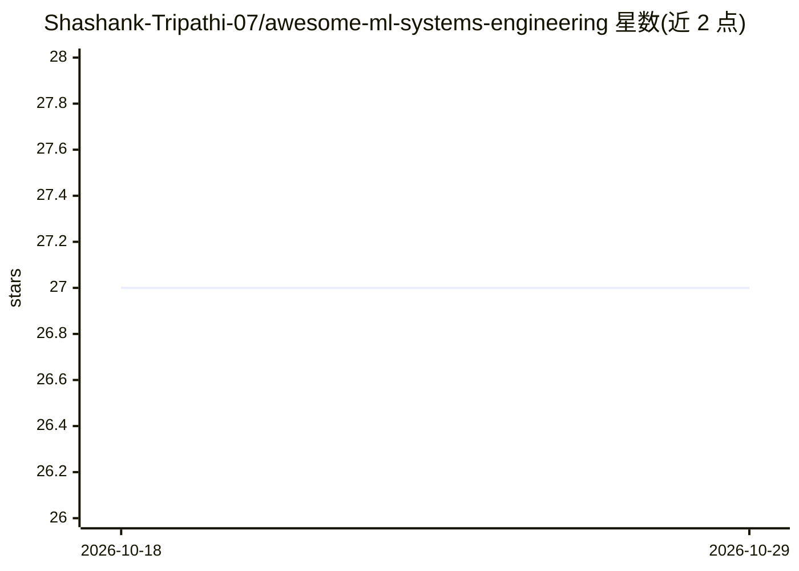

# Shashank-Tripathi-07/awesome-ml-systems-engineering

⭐ 27 · NOASSERTION · 推送 2026-07-04 · [GitHub](https://github.com/Shashank-Tripathi-07/awesome-ml-systems-engineering) · 个人维护

**ML 系统工程资源策展清单：覆盖硬件到生产运维全栈**

由个人维护的 ML Systems Engineering 资源清单，收录经人工筛选的教材、课程、论文、工具与文档，按硬件与加速器、神经网络编译器、内核编程、互连网络、存储、新兴硬件等 8 个大组共 49 个小节组织。附带 ROADMAP.md 学习路线，并按初学者/中级/高级三条路径为不同水平读者给出阅读顺序，条目以难度和类型标记（必读/学术/实操）。资源偏向英文生态，含 Harvard CS249r、Triton、TV M、FlashAttention 等条目。

## 筛选速览

| 维度 | 判定 | 备注 |
|---|---|---|
| AI 角色 | `ai-knowledge` | 知识聚合/清单类 |
| 许可风险 | `none` | NOASSERTION |
| 部署形态 | `None` |  |
| 模型依赖 | — | README 未给出锁定关系 |
| 硬件要求 | — | 无带数字的原话,不猜 |
| 安装摩擦 | `medium` | 含编译或系统依赖之一 |
| 成熟度 | — | 结构信号不足 |

## 能力要点

- 49 个小节覆盖硬件、编译器、分布式训练、推理与生产运维全栈
- 附带 ROADMAP.md 与按水平划分的三条学习路径
- 条目带必读/学术/实操/难度标记，声明经人工筛选

## 适用场景

- 系统化查找 ML 系统工程各环节的教材与工具
- 按自身水平选择学习路径规划入门到进阶
- 跟踪 GPU/编译器/互连等基础设施方向的关键资源

## 场景标签

`精选清单` `教程课程` · 领域:学习与行业

## 证据(README 行号)

> L10: > A curated list of resources covering the full ML Systems Engineering stack: from hardware and compilers to distri
> L12: ML Systems Engineering sits at the intersection of machine learning and systems software. This list is for practiti

## 星数曲线

2026-10-18 27 → 2026-10-29 27（+0）

---
*卡片 v1 · prompt 1.4 · 生成 2026-10-26 · 置信度 high · 依据 README sha `c4df2171f7e0` · [字段定义](../../DATASET.md)*
