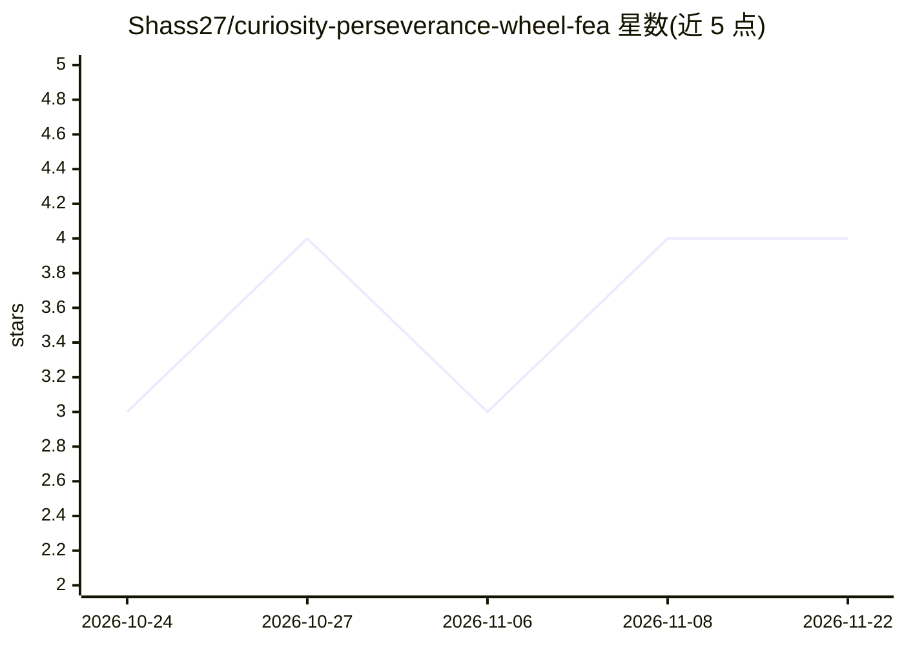

# Shass27/curiosity-perseverance-wheel-fea

⭐ 4 · TeX · NOASSERTION · 推送 2026-11-10 · [GitHub](https://github.com/Shass27/curiosity-perseverance-wheel-fea) · 组织维护

**火星车轮皮 FEA 数据与代理模型库，供研究者即时预测应力应变**

针对好奇号与毅力号火星车轮薄铝皮的两项研究集合：在 Ansys 2025 R1 中完成失效分析（解析梁模型与固体 FEA 对比、网格收敛性验证）与 458 组参数化 FEA 求解；将 440 组结果经 PCA 压缩为 40 个形状模态后用高斯过程回归训练代理模型，附带 MATLAB GUI 即时预测应力/应变图并导出。预训练模型随仓库提交，可直接运行 GUI；重建模型需 MATLAB 及其统计与机器学习工具箱。

## 筛选速览

| 维度 | 判定 | 备注 |
|---|---|---|
| AI 角色 | `ai-native` | 本体是模型或模型工具 |
| 许可风险 | `none` | NOASSERTION |
| 部署形态 | `None` |  |
| 模型依赖 | — | README 未给出锁定关系 |
| 硬件要求 | — | 无带数字的原话,不猜 |
| 安装摩擦 | `low` | 无编译、无系统依赖或容器化 |
| 成熟度 | — | 结构信号不足 |

## 能力要点

- 440 组 Ansys FEA 案例转化为 PCA + 高斯过程的代理模型
- MATLAB GUI 即时预测应力/应变场并与最近 FEA 案例对比
- 训练好的模型文件已提交，无需重跑仿真即可使用
- 含解析失效分析（Peterson 应力集中系数 + 梁模型）与网格收敛研究

## 适用场景

- 不同火星车轮几何参数下即时预测轮皮应力应变
- 复现 FEA 与解析失效分析的对比流程
- 教学示例：PCA 降维与高斯过程代理建模的完整工作流

## 场景标签

 · 领域:工程仿真/科研

## 证据(README 行号)

> L8: The thin aluminium skin of NASA's Curiosity rover wheels cracked and punctured on sharp Martian rocks. For Persevera
> L42: 458 Ansys cases were solved on the curved R250 wheel panel, covering 5 grouser features × 2 thicknesses × 3 angles 
> L68: |MATLAB|R2025b|all analysis scripts and the GUI|

## 星数曲线

2026-10-24 3 → 2026-11-22 4（+1）

---
*卡片 v1 · prompt 1.4 · 生成 2026-11-21 · 置信度 high · 依据 README sha `2f7f6b63d6c4` · [字段定义](../../DATASET.md)*
