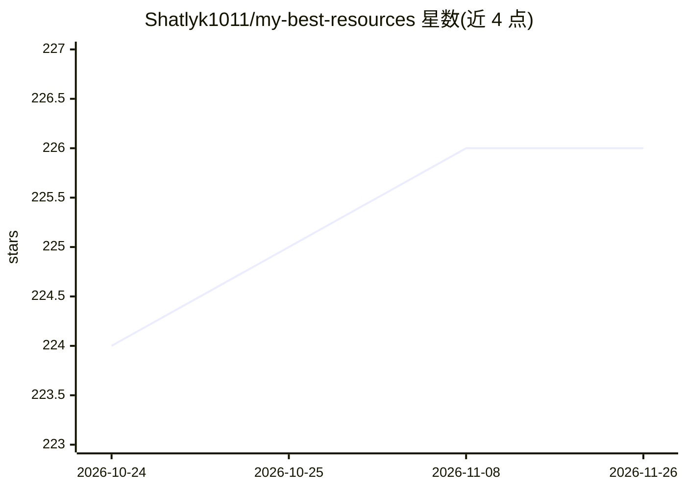

# Shatlyk1011/my-best-resources

⭐ 226 · 推送 2026-11-03 · [GitHub](https://github.com/Shatlyk1011/my-best-resources) · 个人维护

**面向前端开发者与设计师的策划资源清单（设计/组件/素材/工具）**

一个观点式（opinionated）的网络开发与设计资源聚合清单，按设计灵感、AI 技能（Claude/agent 技能）、开源 UI 组件库、图库与图标、视频编辑模板、AI 工具及其它实用服务分节组织，每条以表格形式给出名称与简介。维护者声明未来会持续更新，并配有一段展示资源实际效果的 YouTube 视频。README 未提供安装步骤，定位为链接参考目录。

## 筛选速览

| 维度 | 判定 | 备注 |
|---|---|---|
| AI 角色 | `ai-knowledge` | 知识聚合/清单类 |
| 许可风险 | `none` | — |
| 部署形态 | `None` |  |
| 模型依赖 | — | README 未给出锁定关系 |
| 硬件要求 | — | 无带数字的原话,不猜 |
| 安装摩擦 | `low` | 无编译、无系统依赖或容器化 |
| 成熟度 | — | 结构信号不足 |

## 能力要点

- 按 7 个主题分节的资源表格（灵感/技能/组件/图库/视频/AI 工具等）
- 收录 Claude 类 agent 技能与 AI 编码工具相关条目
- 覆盖 React/Tailwind/GSAP/Motion 等技术栈的开源组件库条目

## 适用场景

- 为网页项目寻找设计灵感与参考站点
- 挑选可安装的开源 UI 组件库
- 查找图库、图标与图片压缩等素材工具

## 场景标签

`精选清单` · 领域:学习与行业

## 证据(README 行号)

> L1: # The Best Resources for Web Developers and Designers (Opinionated)
> L6: ### List of Resources

## 星数曲线

2026-10-24 224 → 2026-11-26 226（+2）

---
*卡片 v1 · prompt 1.4 · 生成 2026-11-25 · 置信度 high · 依据 README sha `fd254f15eff1` · [字段定义](../../DATASET.md)*
