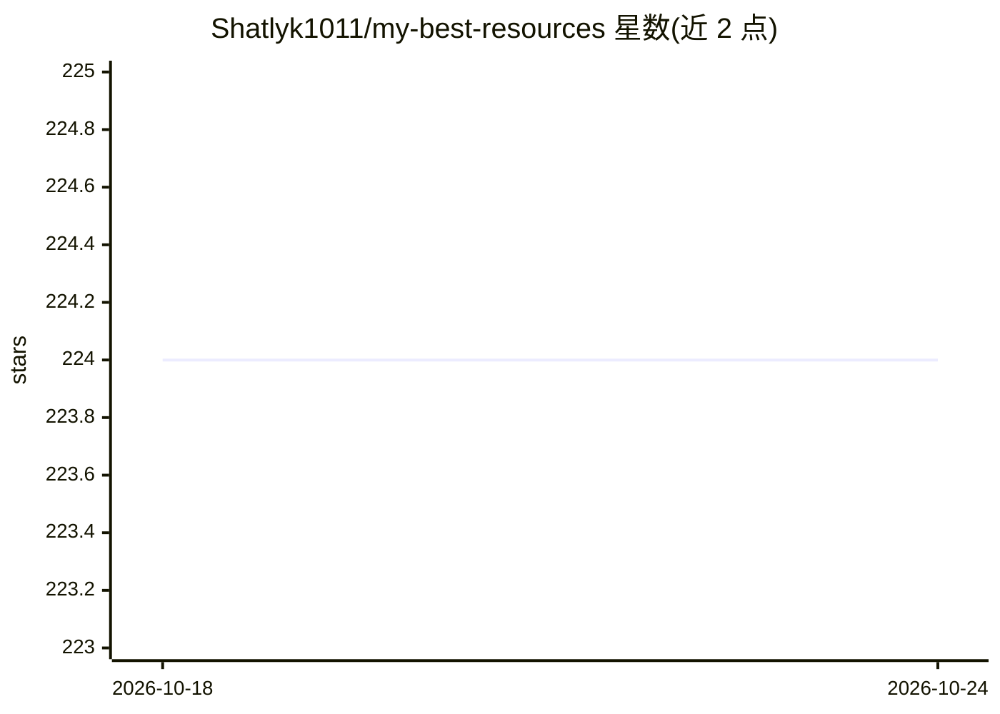

# Shatlyk1011/my-best-resources

⭐ 225 · 推送 2026-10-24 · [GitHub](https://github.com/Shatlyk1011/my-best-resources) · 个人维护

**面向前端开发者与设计师的资源清单（设计/组件/图库/AI 工具）**

个人维护的观点式（Opinionated）资源目录：按设计灵感、技能、开源组件库、图库图标、视频编辑、AI 工具、其他工具等类别收录站点与库，每个条目附简介与技术栈标签（如 Tailwind/React/GSAP）。含少量 AI 相关技能（Claude skill、Procedural Film）与 AI 工具（Ideogram、Magic Patterns 等）。无安装与运行方式，README 另附 YouTube 视频演示，声明将持续更新。

## 筛选速览

| 维度 | 判定 | 备注 |
|---|---|---|
| AI 角色 | `ai-knowledge` | 知识聚合/清单类 |
| 许可风险 | `none` | — |
| 部署形态 | `None` |  |
| 模型依赖 | — | README 未给出锁定关系 |
| 硬件要求 | — | 无带数字的原话,不猜 |
| 安装摩擦 | `low` | 无编译、无系统依赖或容器化 |
| 成熟度 | — | 结构信号不足 |

## 能力要点

- 按 7 个类别组织资源条目，附简介与技术栈标签
- 收录 Shad CN、Aceternity UI 等开源组件库
- 含 AI 工具与 Claude 技能条目
- 配套 YouTube 视频演示各资源实际效果

## 适用场景

- 寻找网页设计灵感与参考站点
- 查找可定制的开源 React/Tailwind 组件库
- 了解前端开发常用的图片、图标与压缩工具

## 场景标签

`精选清单` · 领域:学习与行业

## 证据(README 行号)

> L1: # The Best Resources for Web Developers and Designers (Opinionated)
> L3: A list of awesome resources to make a developer's life easier.
> L6: ### List of Resources

## 星数曲线

2026-10-18 224 → 2026-10-24 224（+0）

---
*卡片 v1 · prompt 1.4 · 生成 2026-10-22 · 置信度 high · 依据 README sha `17b24fe65f2d` · [字段定义](../../DATASET.md)*
