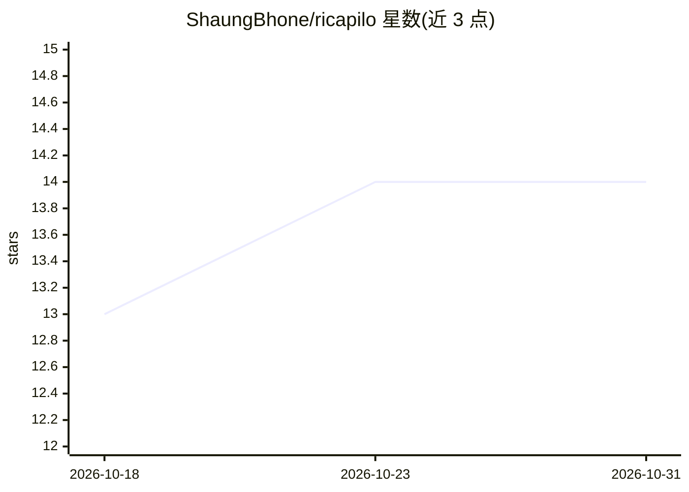

# ShaungBhone/ricapilo

⭐ 14 · TypeScript · MIT · 推送 2026-10-29 · [GitHub](https://github.com/ShaungBhone/ricapilo) · 个人维护

**开源缅语 AI 视频解说工作台：找片、写解说、配音配字幕、导出 MP4**

面向缅语短视频解说的自托管应用：Laravel 13 API + Next.js 16 前端 + 独立 Remotion 渲染服务。通过 YouTube/Bilibili 发现四分钟以内的短视频，用 yt-dlp 取回素材、FFmpeg 分段抽音频，生成缅语解说稿并配音、烧录字幕，经 Remotion 合成导出 MP4。AI 能力经 OpenRouter 调用文本、转录与语音模型，模型目录动态发现、无硬编码音色。附带基于麦克风的轮次对话功能 Browser Talk。Docker Compose 为完整支持部署，本地开发需 PHP 8.3+/Node 24/Bun 及 yt-dlp/FFmpeg。渲染器单并发槽位，字幕时间按段落时长估算而非词级对齐，无时间线编辑器。

## 筛选速览

| 维度 | 判定 | 备注 |
|---|---|---|
| AI 角色 | `ai-native` | 本体是模型或模型工具 |
| 许可风险 | `permissive` | MIT |
| 部署形态 | `self-host` | docker 或自建部署 |
| 模型依赖 | locked-api |  |
| 硬件要求 | — | 无带数字的原话,不猜 |
| 安装摩擦 | `low` | 无编译、无系统依赖或容器化 |
| 成熟度 | — | 结构信号不足 |

## 能力要点

- YouTube/Bilibili 视频发现（限四分钟内）+ 缅语解说生成、配音与烧录字幕
- 经 OpenRouter 动态发现文本/转录/语音模型，可禁用个别模型 ID
- Remotion 渲染器含缅语字体与 Chrome Headless Shell，渲染成功原子替换 recap.mp4
- Browser Talk 轮次对话：录音、静音检测、转录/对话/语音调用

## 适用场景

- 自建缅语影视解说短视频生产流水线
- 上传素材或纯文稿生成带字幕的解说视频
- 本地跑一套完整的发现-生成-配音-渲染工作台

## 场景标签

`语音合成` `视频生成` `AI 写作` · 领域:内容生成

## 证据(README 行号)

> L9: An open-source Burmese AI recap workspace: Laravel 13 API, Next.js 16 frontend, and an isolated Remotion video rende
> L128: The initial video assembly uses available source footage with Burmese narration and burned-in captions. A transcri
> L132: Browser Talk uses microphone recording, silence detection, per-turn OpenRouter transcription/chat/speech calls, pe

## 星数曲线

2026-10-18 13 → 2026-10-31 14（+1）

---
*卡片 v1 · prompt 1.4 · 生成 2026-10-31 · 置信度 mid · 依据 README sha `559891a0474c` · [字段定义](../../DATASET.md)*
