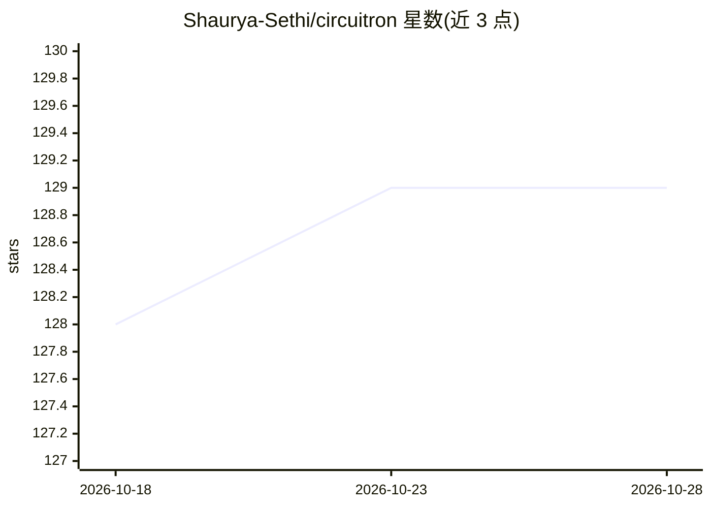

# Shaurya-Sethi/circuitron

⭐ 129 · Python · MIT · 推送 2026-06-06 · [GitHub](https://github.com/Shaurya-Sethi/circuitron) · 个人维护

**多 agent 把自然语言电路需求转成 KiCad 原理图与 PCB**

基于 OpenAI Agents SDK 的 PCB 设计原型工具：规划 agent 将自然语言需求拆解为设计任务，后续 agent 负责 KiCad 库元器件检索、经 MCP 服务器（RAG + Neo4j 知识图谱）获取 SKiDL 文档、生成代码、校验与迭代纠错，最终输出 .sch 原理图、网表与 .kicad_pcb 文件。依赖 Docker 容器化工具链，需 OpenAI API key、Supabase 与 Neo4j 实例。README 声明项目已归档，仍可用但架构与依赖模型反映早期工具形态。

## 筛选速览

| 维度 | 判定 | 备注 |
|---|---|---|
| AI 角色 | `ai-native` | 本体是模型或模型工具 |
| 许可风险 | `permissive` | MIT |
| 部署形态 | `self-host` | docker 或自建部署 |
| 模型依赖 | — | README 未给出锁定关系 |
| 硬件要求 | — | 无带数字的原话,不猜 |
| 安装摩擦 | `low` | 无编译、无系统依赖或容器化 |
| 成熟度 | `idea` | |

## 能力要点

- 多 agent 流水线（规划/选件/生成/校验/ERC 纠错）产出 KiCad 原理图、网表与 PCB 文件
- MCP 服务器提供 SKiDL 文档 RAG 与知识图谱幻觉检查
- 支持 /model 命令交互式切换 OpenAI 模型并内置成本估算
- KiCad、MCP 与 Python 执行环境全部容器化以保证可复现

## 适用场景

- 用自然语言快速生成电路原理图与 PCB 布局的初版原型
- 自动查询 KiCad 库确认元器件真实存在并生成网表
- 在工程师熟悉 KiCad 工具链中审查和定稿生成的设计

## 场景标签

`多智能体` · 领域:Agent 开发

## 证据(README 行号)

> L5: Circuitron is an agent-driven PCB design prototyper that converts natural language requirements into SKiDL scripts, 
> L11: - **Reasoning-driven workflow** – OpenAI Agents coordinate planning, part discovery, code generation, validation, a
> L20: Circuitron orchestrates several specialized agents using the OpenAI Agents SDK. A planning agent first interprets t

## 星数曲线

2026-10-18 128 → 2026-10-28 129（+1）

---
*卡片 v1 · prompt 1.4 · 生成 2026-10-23 · 置信度 mid · 依据 README sha `ac14e259ef6c` · [字段定义](../../DATASET.md)*
