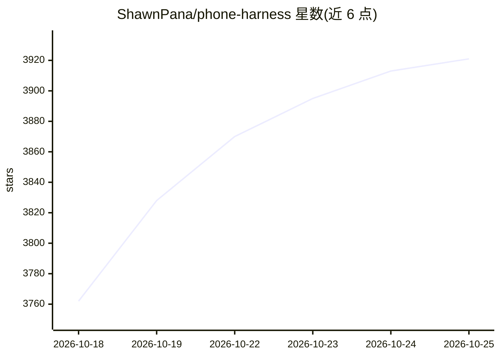

# ShawnPana/phone-harness

⭐ 3,921 · Python · MIT · 推送 2026-10-24 · [GitHub](https://github.com/ShawnPana/phone-harness) · 个人维护

**让编码 agent 直接操控真实手机（iPhone/Android）的工具**

面向 Claude Code、Codex 等 agent 的手机操控工具：iPhone 经 Mac 的 iPhone Mirroring 窗口（Vision OCR 识别文字并发出 HID 级触控事件），Android 经 adb（screencap 截屏、accessibility tree 读文本、input 注入操作），另有云手机（Android 走 adb、iPhone 走 HTTPS，OCR 在宿主机运行）。手机无需越狱或安装任何东西。限制：锁屏解锁需用户、OCR 只识别文字不识别图标、不支持多点触控与相机/Face ID。提供 CLI 与 agent 技能文件，安装经 uv 或 pip，另有 Hermes 集成插件。

## 筛选速览

| 维度 | 判定 | 备注 |
|---|---|---|
| AI 角色 | `ai-ecosystem` | LLM/agent 周边工具 |
| 许可风险 | `permissive` | MIT |
| 部署形态 | `library` | 以包/库形式分发 |
| 模型依赖 | — | README 未给出锁定关系 |
| 硬件要求 | — | 无带数字的原话,不猜 |
| 安装摩擦 | `low` | 无编译、无系统依赖或容器化 |
| 成熟度 | — | 结构信号不足 |

## 能力要点

- iPhone 经 Mirroring 窗口 + Vision OCR 定位文字坐标并发出 HID 触控事件
- Android 经 adb：screencap 截屏、accessibility tree 文本、input 操作，USB/Wi-Fi 均可
- 云手机支持：Android over adb、iPhone over HTTPS，首个 100 分钟免费（仅云 Android 计费）
- 提供 phone-harness doctor 检查连接链路，SKILL.md 作为 agent 日常操作指南

## 适用场景

- 让编码 agent 在真机上完成“帮我叫车”“打开应用”等手机操作任务
- 无实体手机时租用云 iPhone/Android 供 agent 测试与操作
- 为自动化测试或移动端 agent 提供跨平台手机操控接口

## 场景标签

`GUI 自动化` · 领域:效率与自动化

## 证据(README 行号)

> L3: **phone-harness** · let your agent control your phone.
> L5: Connect Claude Code, Codex, or any agent to your real phone. **iPhone** through
> L34: Paste into Claude Code or Codex:

## 星数曲线

2026-10-18 3,762 → 2026-10-25 3,921（+159）

---
*卡片 v1 · prompt 1.4 · 生成 2026-10-20 · 置信度 high · 依据 README sha `e56eddea12f6` · [字段定义](../../DATASET.md)*
